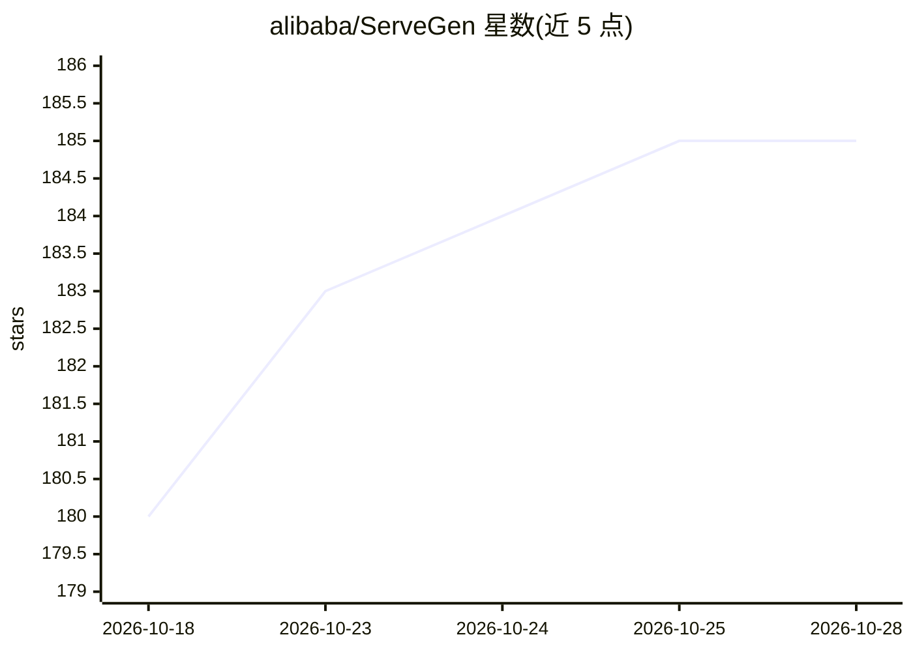

# alibaba/ServeGen

⭐ 187 · Python · Apache-2.0 · 推送 2026-08-27 · [GitHub](https://github.com/alibaba/ServeGen) · 组织维护 · 中文 README

**面向 LLM 推理服务的真实工作负载生成框架**

基于阿里云百炼平台 12 个生产模型数十亿次推理请求的分析构建，用于生成贴近真实场景的 LLM serving 工作负载：覆盖突发请求到达、多日/多周的输入输出长度分布漂移、多模态（Qwen-VL）异构数据构成与推理型（DeepSeek-R1）双峰推理长度分布。以 Python 库形式提供（需 Python 3.8+），内置 LANGUAGE/REASON/MULTIMODAL 三类模型数据集与多轮对话脱敏数据、离线批推理 trace。定位为连接 LLM serving 系统研究与生产实际的桥梁，配有特征分析论文。

## 筛选速览

| 维度 | 判定 | 备注 |
|---|---|---|
| AI 角色 | `ai-ecosystem` | LLM/agent 周边工具 |
| 许可风险 | `permissive` | Apache-2.0 |
| 部署形态 | `library` | 以包/库形式分发 |
| 模型依赖 | — | README 未给出锁定关系 |
| 硬件要求 | — | 无带数字的原话,不猜 |
| 安装摩擦 | `low` | 无编译、无系统依赖或容器化 |
| 成熟度 | — | 结构信号不足 |

## 能力要点

- 基于 12 个生产模型数十亿次请求分析构建
- 支持突发到达、长度分布漂移、多模态与推理型工作负载
- 内置三类模型数据集、多轮对话脱敏数据与离线批推理 trace
- 提供自定义客户端模式与请求速率 CDF 分析

## 适用场景

- 评测和压测 LLM serving 系统时生成贴近生产的请求负载
- 研究推理请求到达模式与长度分布对系统性能的影响
- 为 serving 调度算法提供可复现的工作负载基准

## 场景标签

`模型评测` · 领域:评测与运维

## 证据(README 行号)

> L3: ServeGen is a framework for generating realistic large language model (LLM) serving workloads.
> L4: Powered by the analysis of billions of inference requests across 12 production models on Alibaba Cloud Model Studio 
> L11: We hope ServeGen can become a data-driven bridge between frontier research and production realities when designing 

## 星数曲线

2026-10-18 180 → 2026-10-28 185（+5）

---
*卡片 v1 · prompt 1.4 · 生成 2026-10-23 · 置信度 high · 依据 README sha `fe7f365cdff8` · [字段定义](../../DATASET.md)*
