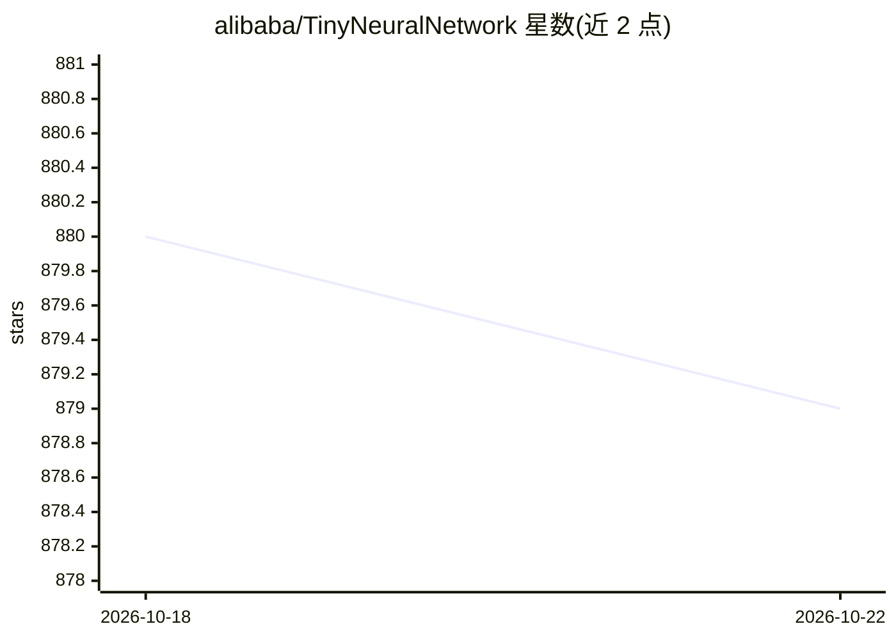

# alibaba/TinyNeuralNetwork

⭐ 879 · Python · MIT · 推送 2026-03-03 · [GitHub](https://github.com/alibaba/TinyNeuralNetwork) · 组织维护 · 中文 README

**深度学习模型压缩框架：剪枝、量化、TFLite 转换，面向边缘部署**

阿里维护的 PyTorch 模型压缩框架，包含计算图捕获、依赖自动解析、剪枝（OneShot/ADMM/NetAdapt 等）、量化感知训练（基于 PyTorch QAT，自动算子融合，支持模拟 bfloat16）与浮点/量化模型到 TFLite 的转换，用于端侧部署；官方称已在天猫精灵、海尔电视、优酷视频、人脸识别考勤机等超过千万台 IoT 设备上应用。要求 Python>=3.9、PyTorch>=1.10，通过 git clone 源码安装或 Docker 构建。因 PyTorch 更新频繁，无法保证所有用例经自动化测试覆盖。

## 筛选速览

| 维度 | 判定 | 备注 |
|---|---|---|
| AI 角色 | `ai-ecosystem` | LLM/agent 周边工具 |
| 许可风险 | `permissive` | MIT |
| 部署形态 | `self-host` | docker 或自建部署 |
| 模型依赖 | — | README 未给出锁定关系 |
| 硬件要求 | — | 无带数字的原话,不猜 |
| 安装摩擦 | `low` | 无编译、无系统依赖或容器化 |
| 成熟度 | — | 结构信号不足 |

## 能力要点

- 图捕获自动驱动剪枝与量化，支持从 PyTorch 模型生成等效模型描述代码
- 实现 OneShot(L1/L2/FPGM)、ADMM、NetAdapt 等多种剪枝算法
- 量化感知训练自动完成算子融合与计算图量化，支持模拟 bfloat16
- 支持浮点与量化 PyTorch 模型到 TFLite 的转换

## 适用场景

- 把 PyTorch 训练的模型压缩后部署到手机或 IoT 端侧设备
- 通过剪枝和量化感知训练减小模型体积、提升推理速度
- 将量化模型转换为 TFLite 格式用于端到端部署

## 场景标签

`模型量化` · 领域:训练与推理

## 证据(README 行号)

> L4: TinyNeuralNetwork is an efficient and easy-to-use deep learning model compression framework, which contains features
> L31: + Model conversion: TinyNeuralNetwork supports conversion of floating-point and quantized PyTorch models to TFLite 

## 星数曲线

2026-10-18 880 → 2026-10-22 879（-1）

---
*卡片 v1 · prompt 1.4 · 生成 2026-10-21 · 置信度 high · 依据 README sha `a237f930fc60` · [字段定义](../../DATASET.md)*
