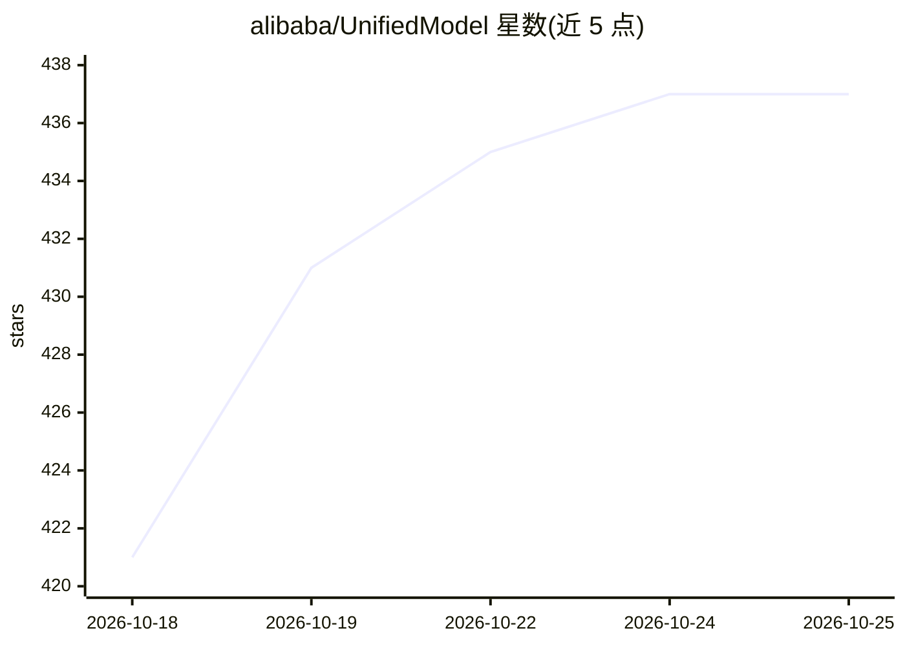

# alibaba/UnifiedModel

⭐ 437 · Go · NOASSERTION · 推送 2026-10-12 · [GitHub](https://github.com/alibaba/UnifiedModel) · [官网](https://alibaba.github.io/UnifiedModel/) · 组织维护 · 中文 README

**面向企业 AI agent 的语义层运行时：统一建模并查询对象图**

UModel 是阿里巴巴开源的厂商中立语义运行时，将企业分散的 schema、实体、业务对象、遥测链接与拓扑关系整合为 workspace 级对象图，供人、系统与 AI agent 通过统一 SPL（.umodel/.entity/.topo）、REST、CLI、SDK 查询。提供 AgentGateway 与 MCP 接入 agent 客户端，支持可加载的 Agent Skills（含根因分析），Web UI 本地浏览工作区。仓库含本地服务、umctl CLI、MCP server、OpenAPI、React UI、示例包与 Docker/Compose 资产；云端控制面、多租户授权等不在开源核心内。

## 筛选速览

| 维度 | 判定 | 备注 |
|---|---|---|
| AI 角色 | `ai-ecosystem` | LLM/agent 周边工具 |
| 许可风险 | `permissive` | NOASSERTION |
| 部署形态 | `None` |  |
| 模型依赖 | — | README 未给出锁定关系 |
| 硬件要求 | — | 无带数字的原话,不猜 |
| 安装摩擦 | `medium` | 含编译或系统依赖之一 |
| 成熟度 | — | 结构信号不足 |

## 能力要点

- workspace 级对象图：模型包定义实体、数据集、链接、存储与拓扑语义
- 统一 SPL 查询面（.umodel/.entity/.topo）+ REST/CLI/SDK 公共契约
- AgentGateway 与 MCP server 供 agent 客户端发现、查询与调用安全工具
- 5 种 GraphStore 后端可选（memory/file/ladybug/neo4j/gremlin）

## 适用场景

- 为 AI agent 提供跨域企业数据的统一语义查询入口
- 统一多源数据治理口径，减少指标对齐与字段翻译成本
- 基于对象图做模型引导的故障根因分析

## 场景标签

`知识图谱` · 领域:知识与检索

## 证据(README 行号)

> L10: UModel (Unified Model) is a vendor-neutral semantic runtime for enterprise AI, data governance, and operational int
> L17: - Connect agent clients through AgentGateway and MCP.
> L101: - AgentGateway and MCP expose discovery, resources, query examples, and safe tools for agent clients.

## 星数曲线

2026-10-18 421 → 2026-10-25 437（+16）

---
*卡片 v1 · prompt 1.4 · 生成 2026-10-21 · 置信度 high · 依据 README sha `444d45cdad9a` · [字段定义](../../DATASET.md)*
