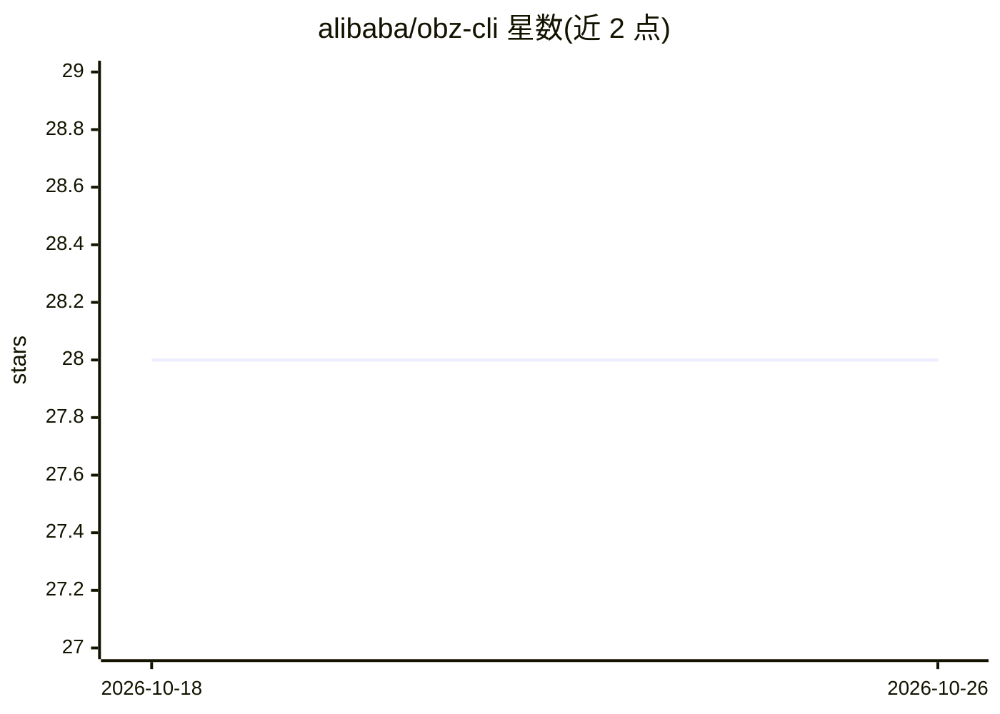

# alibaba/obz-cli

⭐ 28 · Rust · Apache-2.0 · 推送 2026-07-11 · [GitHub](https://github.com/alibaba/obz-cli) · 组织维护 · 中文 README

**统一查询 10+ 可观测性后端的 Rust CLI，面向 AI Agent**

Rust 编写的多后端可观测性命令行工具：用一组统一命令查询指标、日志与链路追踪，覆盖 VictoriaMetrics、Prometheus、Loki、Jaeger、Elasticsearch、Datadog、阿里云 SLS 等 10+ 后端，底层透传原生查询语言（PromQL/LogQL/TraceQL 等）。面向 AI Agent 场景设计：默认 JSON 输出、结构化错误（类别/退出码/可恢复性/修复建议）、内置 per-provider 技能文档与 --fields/--truncate 输出裁剪以降低 token 消耗。配置文件预置端点与凭据（token/basic auth/credential-process，支持环境变量与文件引用）。由 alibaba 组织维护，Apache-2.0 许可。

## 筛选速览

| 维度 | 判定 | 备注 |
|---|---|---|
| AI 角色 | `ai-ecosystem` | LLM/agent 周边工具 |
| 许可风险 | `permissive` | Apache-2.0 |
| 部署形态 | `None` |  |
| 模型依赖 | — | README 未给出锁定关系 |
| 硬件要求 | — | 无带数字的原话,不猜 |
| 安装摩擦 | `low` | 无编译、无系统依赖或容器化 |
| 成熟度 | — | 结构信号不足 |

## 能力要点

- 一组命令统一查询 10+ 可观测性后端的 metrics/logs/traces
- 默认 JSON 输出、确定性退出码与结构化错误响应
- 内置面向 AI Agent 的 per-provider 技能文档
- 三层架构（CLI/核心框架/provider 适配器），新增后端无需改核心

## 适用场景

- 让 AI Agent 跨多个监控后端可靠地查询指标、日志与链路
- 用单一 CLI 替代多个后端各自的命令行与查询语法
- 在配置文件中预置各后端凭据后用 -p 快速查询

## 场景标签

 · 领域:可观测性/运维工具

## 证据(README 行号)

> L11: A multi-backend observability CLI for metrics, logs, and traces — unified interface, AI-Agent friendly. Currently s
> L24: - **Agent-first** — Default JSON output with structured error responses (category, exit code, recoverability, fix s

## 星数曲线

2026-10-18 28 → 2026-10-26 28（+0）

---
*卡片 v1 · prompt 1.4 · 生成 2026-10-26 · 置信度 mid · 依据 README sha `60ff8f3007cf` · [字段定义](../../DATASET.md)*
