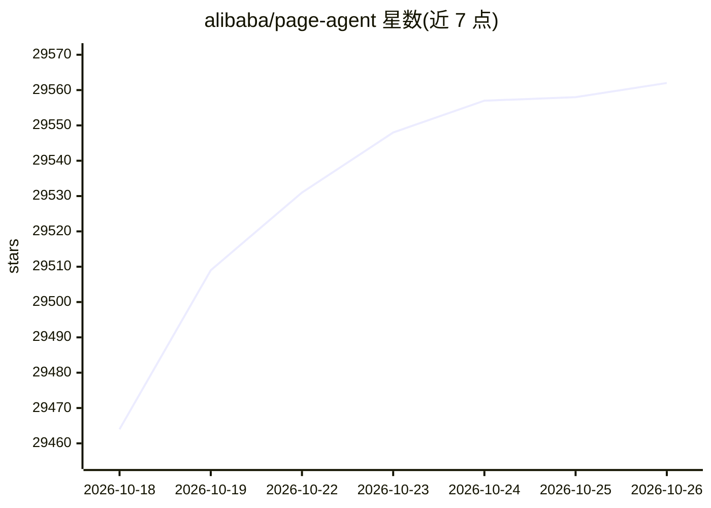

# alibaba/page-agent

⭐ 29,562 · TypeScript · MIT · 推送 2026-10-21 · [GitHub](https://github.com/alibaba/page-agent) · [官网](https://alibaba.github.io/page-agent/) · 组织维护 · 中文 README

**网页内嵌 JS GUI agent：让任意网页支持自然语言控制**

以页内 JavaScript 形式提供 GUI agent，通过文本化 DOM 操作执行任务，不依赖浏览器扩展、Python 或无头浏览器，也不使用截图或多模态模型；一行 script 标签或 npm 安装即可集成到任意网页。支持接入大多数主流模型（含本地部署模型），可选 Chrome 扩展支持跨页面任务，并提供 Beta 版 MCP Server 供外部 agent 客户端控制浏览器。基于 browser-use 的 DOM 处理组件与 prompt，定位为客户端网页增强而非服务端自动化。MIT 协议。

## 筛选速览

| 维度 | 判定 | 备注 |
|---|---|---|
| AI 角色 | `ai-native` | 本体是模型或模型工具 |
| 许可风险 | `permissive` | MIT |
| 部署形态 | `library` | 以包/库形式分发 |
| 模型依赖 | — | README 未给出锁定关系 |
| 硬件要求 | — | 无带数字的原话,不猜 |
| 安装摩擦 | `low` | 无编译、无系统依赖或容器化 |
| 成熟度 | — | 结构信号不足 |

## 动量与使用信号

- 维护:`active` — 距上次 push 4.0 天,年发版 39,33 位贡献者
- 涨星:近 1 天 **+8**(自 20261016 起算)
- 安装:npm 包 `page-agent` 月下载 94,442
- 平台:WEB · 协议:MCP

## 能力要点

- 页内 JavaScript 集成，无需扩展/Python/无头浏览器
- 基于文本 DOM 操作，无需截图与多模态 LLM
- 支持主流模型及本地部署模型
- 提供 Chrome 扩展（多页任务）与 MCP Server (Beta)

## 适用场景

- 在 SaaS 产品中内置 AI copilot 而不重写后端
- 把 ERP/CRM 中多步骤表单操作变成一句话指令
- 让 Web 应用通过自然语言（含语音）无障碍使用

## 场景标签

`浏览器自动化` · 领域:效率与自动化

## 证据(README 行号)

> L14: The GUI Agent Living in Your Webpage. One script gives any web page its own AI agent.
> L28:  - Just in-page javascript. Everything happens in your web page.
> L94: `PageAgent` is designed for **client-side web enhancement**, not server-side automation.

## 星数曲线

2026-10-18 29,464 → 2026-10-26 29,562（+98）

---
*卡片 v1 · prompt 1.4 · 生成 2026-10-18 · 置信度 high · 依据 README sha `5e66ae8202d1` · [字段定义](../../DATASET.md)*
