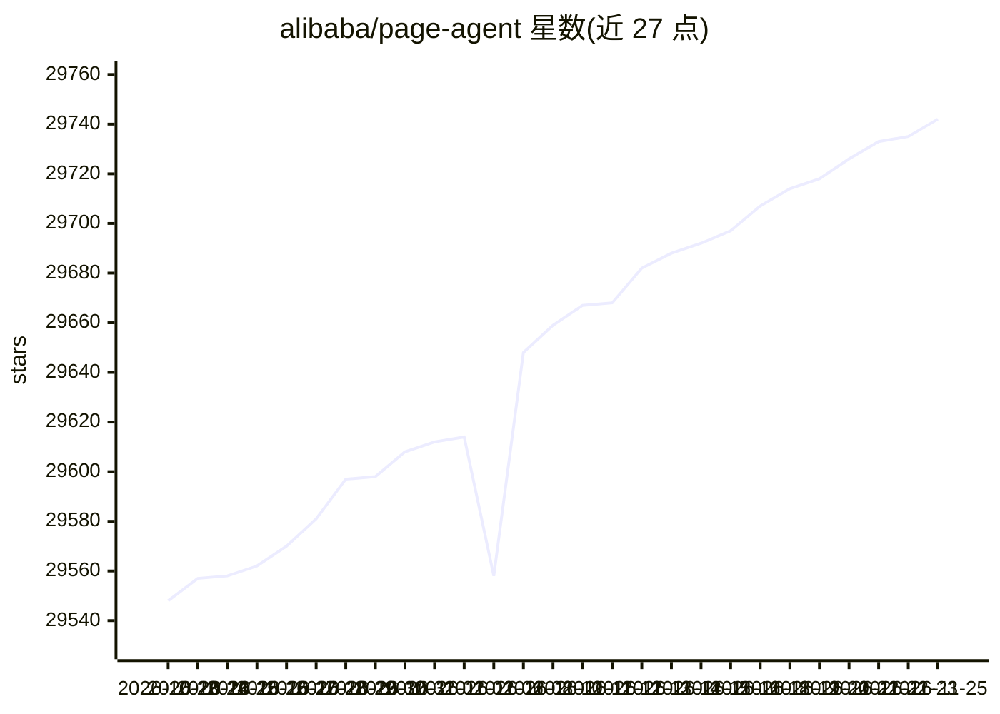

# alibaba/page-agent

⭐ 29,742 · TypeScript · MIT · 推送 2026-11-23 · [GitHub](https://github.com/alibaba/page-agent) · [官网](https://alibaba.github.io/page-agent/) · 组织维护 · 中文 README

**为网页内嵌自然语言控制的 GUI Agent JS 库**

一个页面内运行的 JavaScript GUI Agent 库：注入一段脚本即可让网页获得由自然语言驱动的 AI agent，基于文本 DOM 操作而非截图，无需浏览器扩展、Python 或无头浏览器；可通过 npm 安装或 CDN 一行引入，提供带免费测试 LLM 的 demo 通道、可选 Chrome 扩展支持多页面任务，以及 Beta 版 MCP Server 供外部 agent 客户端控制。由 Alibaba 维护，MIT 许可，实现基于 browser-use 的 DOM 处理组件与提示词。

## 筛选速览

| 维度 | 判定 | 备注 |
|---|---|---|
| AI 角色 | `ai-ecosystem` | LLM/agent 周边工具 |
| 许可风险 | `permissive` | MIT |
| 部署形态 | `library` | 以包/库形式分发 |
| 模型依赖 | — | README 未给出锁定关系 |
| 硬件要求 | — | 无带数字的原话,不猜 |
| 安装摩擦 | `low` | 无编译、无系统依赖或容器化 |
| 成熟度 | — | 结构信号不足 |

## 动量与使用信号

- 维护:`active` — 距上次 push 4.0 天,年发版 39,33 位贡献者
- 涨星:近 1 天 **+8**(自 20261016 起算)
- 安装:npm 包 `page-agent` 月下载 94,442
- 平台:WEB · 协议:MCP

## 能力要点

- 纯页面内 JavaScript 集成，无需扩展/Python/无头浏览器
- 基于文本 DOM 操作，无需截图与多模态 LLM
- 自带 LLM 接入，支持包括本地部署在内的主流模型
- 可选 Chrome 扩展（多页面任务）与 MCP Server（Beta）

## 适用场景

- 在自己的 SaaS 产品中用几行代码加入 AI copilot
- 把 ERP/CRM 等系统中 20 次点击的流程变成一句话完成
- 让 Web 应用支持自然语言与语音操作以提升无障碍性
- 通过 MCP 让 agent 客户端控制浏览器

## 场景标签

`浏览器自动化` · 领域:效率与自动化

## 证据(README 行号)

> L14: The GUI Agent Living in Your Webpage. One script gives any web page its own AI agent.
> L27:  - No need for `browser extension` / `python` / `headless browser`.
> L28:  - Just in-page javascript. Everything happens in your web page.

## 星数曲线

2026-10-23 29,548 → 2026-11-25 29,742（+194）

---
*卡片 v1 · prompt 1.4 · 生成 2026-11-22 · 置信度 high · 依据 README sha `c256cf184b1b` · [字段定义](../../DATASET.md)*
