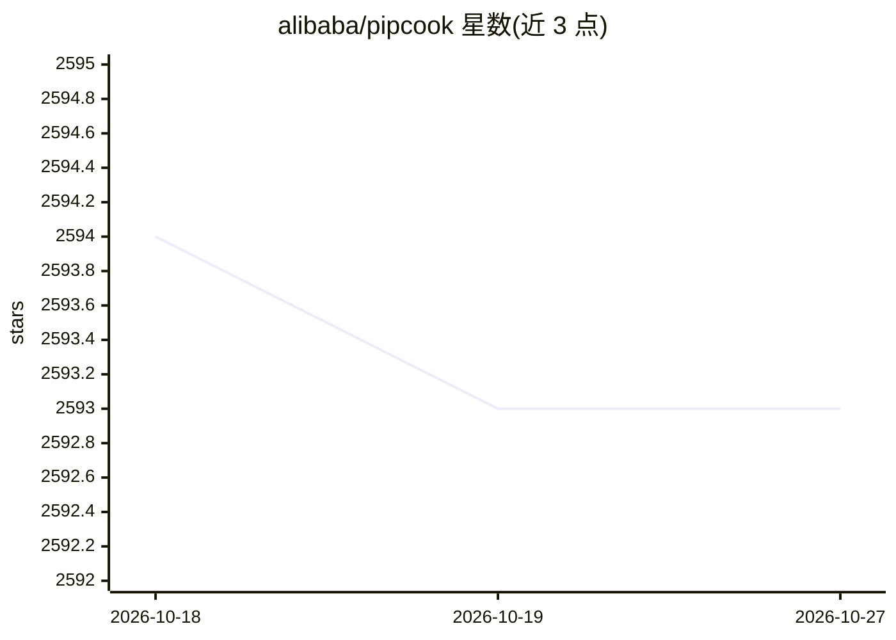

# alibaba/pipcook

⭐ 2,593 · TypeScript · Apache-2.0 · 推送 2026-10-26 · [GitHub](https://github.com/alibaba/pipcook) · [官网](https://alibaba.github.io/pipcook/) · 组织维护 · 中文 README

**面向 Web 工程师的 JavaScript 机器学习应用框架**

阿里巴巴开源的机器学习应用框架，目标让 JavaScript 工程师无需前置知识即可训练和部署模型。提供子项目包括：机器学习 pipeline 框架（数据集、训练、验证、部署均以插件机制支持）、项目管理工具，以及通过 Boa 模块经 N-API 桥接 CPython 接口，使开发者在 Node.js 运行时使用 numpy、scikit-learn、tensorflow 等 Python 生态包。训练产出为含模型与 JS 函数的 NPM 包，可用 pipcook CLI 训练、预测并启动推理服务；限定每条 pipeline 最后阶段必须输出训练好的模型。

## 筛选速览

| 维度 | 判定 | 备注 |
|---|---|---|
| AI 角色 | `ai-ecosystem` | LLM/agent 周边工具 |
| 许可风险 | `permissive` | Apache-2.0 |
| 部署形态 | `library` | 以包/库形式分发 |
| 模型依赖 | — | README 未给出锁定关系 |
| 硬件要求 | — | 无带数字的原话,不猜 |
| 安装摩擦 | `low` | 无编译、无系统依赖或容器化 |
| 成熟度 | — | 结构信号不足 |

## 能力要点

- 以插件机制组织数据集/训练/验证/部署的 ML pipeline 框架
- Boa 模块通过 N-API 桥接 CPython，在 Node.js 中调用 Python 生态包
- 训练产出为包含模型与 JavaScript 函数的 NPM 包，pipcook serve 可直接部署推理服务
- 提供图像分类、目标检测、文本分类等示例 pipeline 及在线 Playground

## 适用场景

- 前端工程师用 JavaScript 完成模型训练、评估与部署
- 训练图像分类/目标检测模型并直接在 Web 服务中使用
- 在 Node.js 运行时调用 numpy、scikit-learn 等 Python 包

## 场景标签

`MLOps` `模型训练` · 领域:训练与推理

## 证据(README 行号)

> L39: The project provides subprojects including machine learning pipeline framework, management tools, a JavaScript runt

## 星数曲线

2026-10-18 2,594 → 2026-10-27 2,593（-1）

---
*卡片 v1 · prompt 1.4 · 生成 2026-10-21 · 置信度 high · 依据 README sha `626806849cc7` · [字段定义](../../DATASET.md)*
