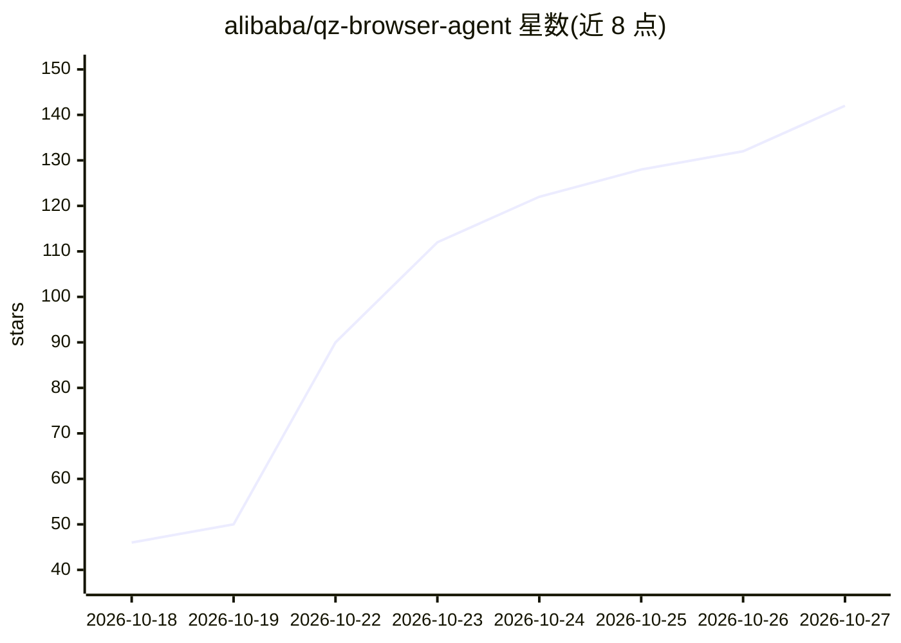

# alibaba/qz-browser-agent

⭐ 142 · HTML · Apache-2.0 · 推送 2026-10-23 · [GitHub](https://github.com/alibaba/qz-browser-agent) · [官网](https://alibaba.github.io/qz-browser-agent/) · 组织维护 · 中文 README

**本地优先的开源 Chrome 浏览器 agent：自动执行网页任务与数据提取**

以 Chrome 扩展形式运行的浏览器 agent：用户用一句话描述任务，它在已登录的真实 Chrome 中跨站点执行浏览流程，交付带来源的表格、文件或报告。自带模型（BYOK），支持 DeepSeek、OpenAI、Claude、OpenRouter 等预设供应商及兼容的本地模型服务器。任务数据存储在本地，无 qz 服务器。支持并行任务与子任务，可将成功任务保存为可复用 Skill；编码类 agent（如 Claude Code、Codex）可通过 CLI 和 MCP 将网页任务委托给它。许可为 Apache-2.0。

## 筛选速览

| 维度 | 判定 | 备注 |
|---|---|---|
| AI 角色 | `ai-native` | 本体是模型或模型工具 |
| 许可风险 | `permissive` | Apache-2.0 |
| 部署形态 | `library` | 以包/库形式分发 |
| 模型依赖 | locked-api |  |
| 硬件要求 | — | 无带数字的原话,不猜 |
| 安装摩擦 | `low` | 无编译、无系统依赖或容器化 |
| 成熟度 | — | 结构信号不足 |

## 能力要点

- 在用户已登录的真实 Chrome 中执行浏览任务，数据本地存储
- BYOK 接入 DeepSeek/OpenAI/Claude/OpenRouter 等供应商及本地模型
- 并行任务与子任务拆分，任务可保存为一句复用的 Skill
- 提供 CLI 与 MCP 通道，供 Claude Code/Codex 等 agent 委托任务

## 适用场景

- 一句话让 agent 跨多个网站收集资料并生成带来源的对比表格
- 把重复的网页流程保存成 Skill，下次一句话复用
- 让编程 agent 通过 CLI/MCP 把网页浏览任务交给 qz 执行

## 场景标签

`浏览器自动化` `网页抓取` · 领域:效率与自动化

## 证据(README 行号)

> L10: qz is an open-source browser agent that runs in your own browser as a Chrome extension. Describe a task in one sent
> L5:  Open-source, local-first browser agent
> L137: qz runs entirely in your browser. Sessions, Skills, and collected data stay on your machine, and the CLI/MCP bridg

## 星数曲线

2026-10-18 46 → 2026-10-27 142（+96）

---
*卡片 v1 · prompt 1.4 · 生成 2026-10-23 · 置信度 high · 依据 README sha `7ec535f5c390` · [字段定义](../../DATASET.md)*
