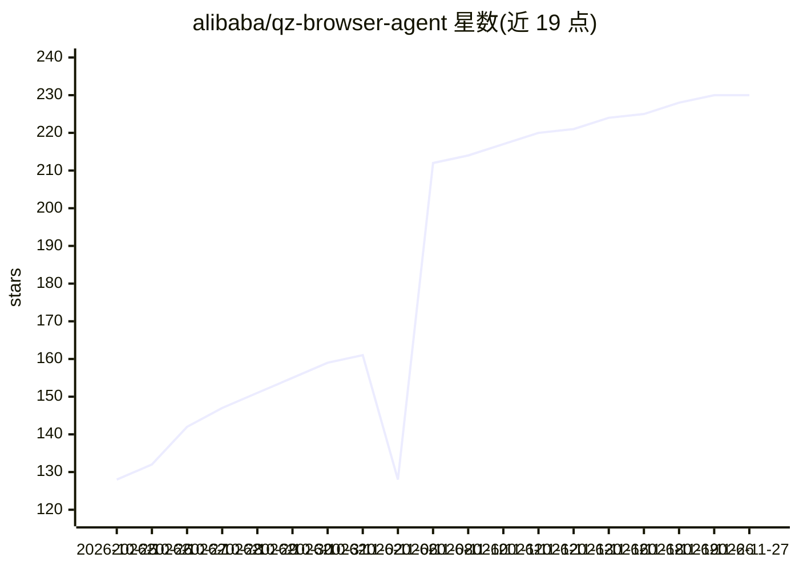

# alibaba/qz-browser-agent

⭐ 230 · HTML · Apache-2.0 · 推送 2026-11-14 · [GitHub](https://github.com/alibaba/qz-browser-agent) · [官网](https://alibaba.github.io/qz-browser-agent/) · 组织维护 · 中文 README

**本地优先的 Chrome 浏览器 AI 代理：自动化、研究与数据提取**

以 Chrome 扩展形式运行的浏览器代理，在用户已登录的真实浏览器中执行任务：一句话描述任务后跨站点操作、提取数据并输出带来源的表格、文件或报告。支持并行任务与子任务拆分，可将跑通的任务保存为可复用 Skill；模型由用户自带 API key 接入，数据留在本地。另提供 CLI 与 MCP 通道，供 Claude Code、Codex 等编码代理驱动浏览器或委托整个网页任务。支持 Chrome 与 Edge，Firefox 需临时加载。

## 筛选速览

| 维度 | 判定 | 备注 |
|---|---|---|
| AI 角色 | `ai-native` | 本体是模型或模型工具 |
| 许可风险 | `permissive` | Apache-2.0 |
| 部署形态 | `library` | 以包/库形式分发 |
| 模型依赖 | locked-api |  |
| 硬件要求 | — | 无带数字的原话,不猜 |
| 安装摩擦 | `low` | 无编译、无系统依赖或容器化 |
| 成熟度 | — | 结构信号不足 |

## 能力要点

- Chrome 扩展 + 侧边栏，可直接介入或停止任务
- 并行任务与子任务拆分，聚合多来源数据为对比表
- 一句话将任务保存为可复用 Skill
- CLI 与 MCP 通道供外部编码代理调用

## 适用场景

- 在已登录的浏览器里跨站点收集并整理数据表格
- 让编码代理把网页浏览类子任务委托给 qz
- 把常用的网页研究流程存成 Skill 反复调用
- 对比多个网站上的信息并生成带来源的报告

## 场景标签

`浏览器自动化` `网页抓取` `编码 Agent` · 领域:效率与自动化

## 证据(README 行号)

> L10: qz is an open-source browser agent that runs in your own browser as a Chrome extension. Describe a task in one sent
> L141: qz runs entirely in your browser. Sessions, Skills, and collected data stay on your machine, and the CLI/MCP bridg
> L161: Use a provider with a supported protocol and tool calling, including a compatible local server.

## 星数曲线

2026-10-25 128 → 2026-11-27 230（+102）

---
*卡片 v1 · prompt 1.4 · 生成 2026-11-25 · 置信度 high · 依据 README sha `55a18984a3c4` · [字段定义](../../DATASET.md)*
