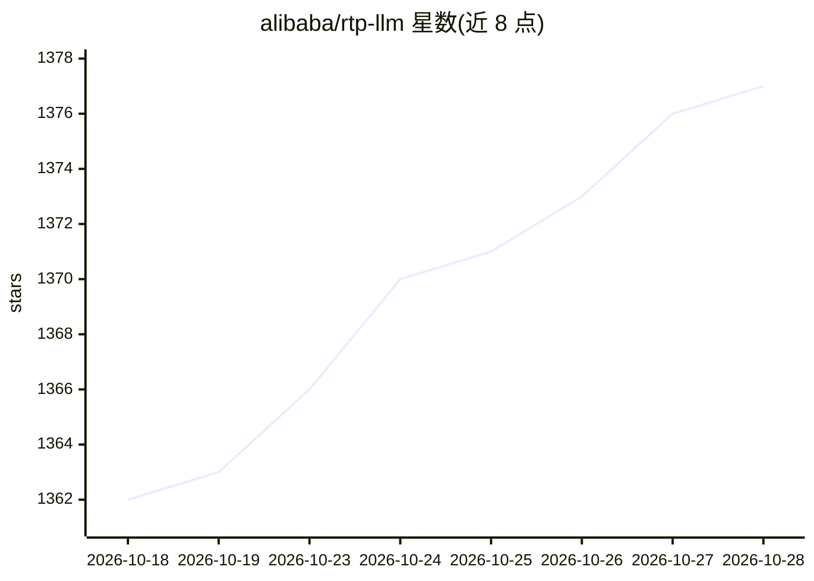

# alibaba/rtp-llm

⭐ 1,377 · Python · Apache-2.0 · 推送 2026-10-28 · [GitHub](https://github.com/alibaba/rtp-llm) · 组织维护 · 中文 README

**阿里开发的高性能 LLM 推理加速引擎**

由阿里巴巴基础模型推理团队开发的大语言模型推理加速引擎，在阿里集团内多业务线部署（淘宝、天猫、闲鱼、菜鸟、高德、饿了么、AE、Lazada 等）。使用 PagedAttention、FlashAttention、FlashDecoding 等 CUDA 算子，支持 WeightOnly INT8/INT4（GPTQ、AWQ）量化、自适应 KVCache 量化、多机多卡张量并行、单实例多 LoRA 服务、多模态输入与投机解码；兼容 HuggingFace 权重格式（SafeTensors/Pytorch/Megatron），并支持 Prefill/Decode 分离架构与 ARM CPU（含 Yitian）上运行 Qwen 系列模型。为 havenask 项目的子项目。

## 筛选速览

| 维度 | 判定 | 备注 |
|---|---|---|
| AI 角色 | `ai-ecosystem` | LLM/agent 周边工具 |
| 许可风险 | `permissive` | Apache-2.0 |
| 部署形态 | `None` |  |
| 模型依赖 | — | README 未给出锁定关系 |
| 硬件要求 | — | 无带数字的原话,不猜 |
| 安装摩擦 | `medium` | 含编译或系统依赖之一 |
| 成熟度 | — | 结构信号不足 |

## 能力要点

- PagedAttention/FlashAttention/FlashDecoding 高性能 CUDA 算子
- INT8/INT4（GPTQ、AWQ）量化与自适应 KVCache 量化
- 多机多 GPU 张量并行、单实例多 LoRA 服务、多模态输入
- Prefill/Decode 分离架构；Qwen 系列支持 Yitian ARM CPU

## 适用场景

- 在 GPU 或 ARM CPU 服务器上部署 LLM 推理服务
- 通过量化降低大模型服务成本
- 单实例承载多 LoRA 模型服务
- 多轮对话场景利用 Prefix Cache 与 System Prompt Cache 加速

## 场景标签

`推理引擎` · 领域:训练与推理

## 证据(README 行号)

> L25: RTP-LLM is a Large Language Model (LLM) inference acceleration engine developed by Alibaba's Foundation Model Infer
> L39: * Utilizes high-performance CUDA kernels, including PagedAttention, FlashAttention, FlashDecoding, etc.

## 星数曲线

2026-10-18 1,362 → 2026-10-28 1,377（+15）

---
*卡片 v1 · prompt 1.4 · 生成 2026-10-21 · 置信度 high · 依据 README sha `1421d9220901` · [字段定义](../../DATASET.md)*
