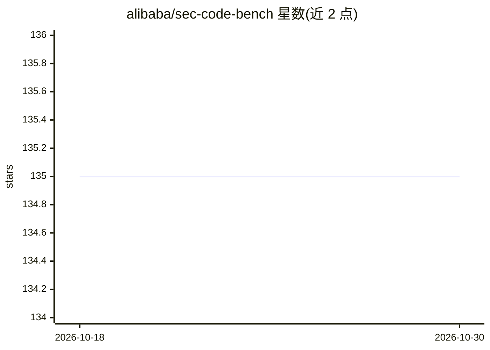

# alibaba/sec-code-bench

⭐ 135 · Python · Apache-2.0 · 推送 2026-10-12 · [GitHub](https://github.com/alibaba/sec-code-bench) · [官网](https://alibaba.github.io/sec-code-bench/) · 组织维护 · 中文 README

**面向 Agentic Coding Tool 的代码安全评测基准套件**

阿里联合清华、浙大、复旦、北大开发的 AI 生成代码安全评测基准：98 个测试用例覆盖 5 种语言（Java/Python/C++/Go/Node.js）与 22 类 CWE，用例多源自阿里真实历史漏洞的匿名化改造，经三人同行评审。评测遵循功能优先原则，采用动态 PoC 执行验证为主、LLM-as-a-Judge 补充的分层策略，输出加权总分。框架支持模型 API 与 IDE 插件、CLI 工具的端到端自动化评测，通过 Docker Compose 运行，配置 YAML 指定被测模型与裁判模型。注意该仓库已声明停止维护，迁移至新仓库。

## 筛选速览

| 维度 | 判定 | 备注 |
|---|---|---|
| AI 角色 | `ai-ecosystem` | LLM/agent 周边工具 |
| 许可风险 | `permissive` | Apache-2.0 |
| 部署形态 | `self-host` | docker 或自建部署 |
| 模型依赖 | — | README 未给出锁定关系 |
| 硬件要求 | — | 无带数字的原话,不猜 |
| 安装摩擦 | `low` | 无编译、无系统依赖或容器化 |
| 成熟度 | — | 结构信号不足 |

## 能力要点

- 98 个测试用例覆盖 5 种语言与 22 类 CWE，四种测试模式（生成/修复 × 原生/安全提示）
- 功能优先 + 动态 PoC 验证 + LLM-as-a-Judge 分层安全评测
- 支持模型 API 多轮对话测试与 IDE 插件/CLI 类 agentic 工具的端到端评测
- Docker Compose 部署评测流程与共享 verifier 服务，生成可视化报告

## 适用场景

- 评测 LLM 或编程 agent 生成代码的安全能力
- 对比不同模型在安全感知与代码修复场景下的表现
- 学术研究中作为代码安全基准进行复现实验

## 场景标签

`模型评测` `网络安全` · 领域:评测与运维

## 证据(README 行号)

> L13: SecCodeBench is a benchmark suite for evaluating the security of AI-generated code, specifically designed for moder
> L35: * **Framework**: We provide a highly extensible testing framework. It not only supports standard multi-turn dialogu

## 星数曲线

2026-10-18 135 → 2026-10-30 135（+0）

---
*卡片 v1 · prompt 1.4 · 生成 2026-10-23 · 置信度 high · 依据 README sha `7ae2f0c91539` · [字段定义](../../DATASET.md)*
