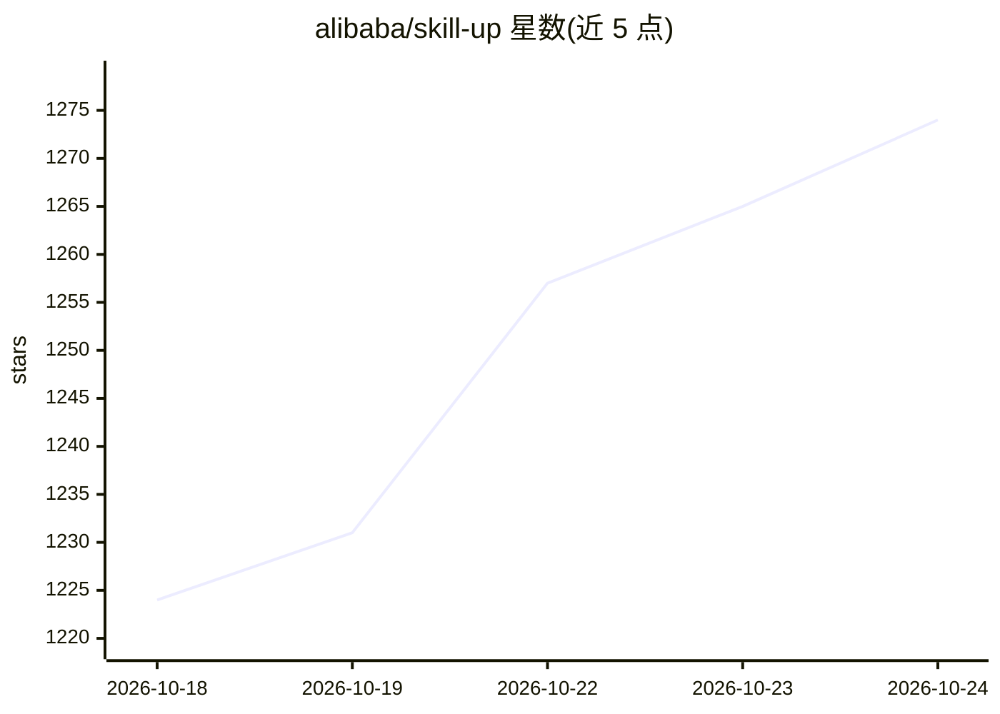

# alibaba/skill-up

⭐ 1,274 · Go · Apache-2.0 · 推送 2026-10-23 · [GitHub](https://github.com/alibaba/skill-up) · [官网](https://alibaba.github.io/skill-up/) · 组织维护 · 中文 README

**Agent Skills / Agent / 工作区的评测与进化 CLI 工具**

Go 编写的 CLI，对 Agent Skills、Agent 引擎及其工作区运行声明式评测用例（eval.yaml + cases/*.yaml），通过规则、脚本或 agent_judge 三种策略对回答与工作区变更评分，本地或 CI 中输出 grading.json、JUnit XML、HTML 等结构化报告。支持 Qoder CLI、Claude Code、Codex 等内置引擎及自定义引擎，可为每个用例准备本地/Docker/OpenSandbox 运行时并安装 MCP 服务器。随附 skill-upper 技能，通过对话创建评测、诊断失败、修复评测套件并循环迭代；兼容导入 Anthropic 风格 evals.json，另提供 GitHub Action。

## 筛选速览

| 维度 | 判定 | 备注 |
|---|---|---|
| AI 角色 | `ai-ecosystem` | LLM/agent 周边工具 |
| 许可风险 | `permissive` | Apache-2.0 |
| 部署形态 | `library` | 以包/库形式分发 |
| 模型依赖 | — | README 未给出锁定关系 |
| 硬件要求 | — | 无带数字的原话,不猜 |
| 安装摩擦 | `low` | 无编译、无系统依赖或容器化 |
| 成熟度 | — | 结构信号不足 |

## 能力要点

- 声明式 eval.yaml + cases/*.yaml 用例格式，三种判定策略（rule_based/script/agent_judge）
- 多引擎支持：Qoder CLI、Claude Code、Codex 内置，另支持 engine.custom 自定义引擎
- skill-upper 技能通过对话驱动评测创建、失败诊断与回归迭代
- 输出 Anthropic 兼容 grading.json/benchmark.json 及 JUnit XML、HTML 报告，并提供 GitHub Action

## 适用场景

- 在 CI 中对 Agent Skill 做回归评测，防止行为退化
- 对比同一 Skill 安装前后的 Agent 行为差异
- 在真实仓库 fixture 或本地工作区中评测 Agent 的文件操作能力
- 通过对话让 AI 代为编写评测用例并迭代修复 Skill

## 场景标签

`模型评测` · 领域:评测与运维

## 证据(README 行号)

> L40: **skill-up** is a CLI for evaluating Agent Skills, agents, and their workspaces. It runs declarative cases against 
> L57: - **Flexible Judging**: Supports `rule_based`, `script`, and `agent_judge` evaluation strategies.

## 星数曲线

2026-10-18 1,224 → 2026-10-24 1,274（+50）

---
*卡片 v1 · prompt 1.4 · 生成 2026-10-21 · 置信度 high · 依据 README sha `c275f3ab8d67` · [字段定义](../../DATASET.md)*
