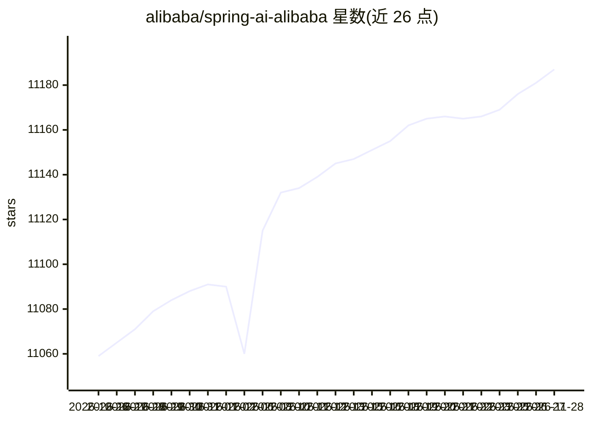

# alibaba/spring-ai-alibaba

⭐ 11,187 · Java · Apache-2.0 · 推送 2026-11-27 · [GitHub](https://github.com/alibaba/spring-ai-alibaba) · [官网](https://java2ai.com) · 组织维护 · 中文 README

**Java 开发者构建 Agent、工作流与多智能体应用的框架**

面向 Java 开发者的 Agentic AI 框架，基于 Spring AI/Spring Boot 构建。包含 Agent Framework（内置 Context Engineering 与 Human In The Loop，提供 SequentialAgent/ParallelAgent/RoutingAgent/LoopAgent 等内置流程）、Graph 运行时（持久化、编排、流式、状态管理）、Admin 可视化平台（Agent 开发、可观测性、评估、MCP 管理）与 Studio 调试 UI。支持 MCP、A2A 通信（Nacos 集成）、多模态输入与语音 Agent。需 JDK 17+ 与 DashScope API key 运行示例，通过 Maven 引入依赖。

## 筛选速览

| 维度 | 判定 | 备注 |
|---|---|---|
| AI 角色 | `ai-ecosystem` | LLM/agent 周边工具 |
| 许可风险 | `permissive` | Apache-2.0 |
| 部署形态 | `None` |  |
| 模型依赖 | — | README 未给出锁定关系 |
| 硬件要求 | — | 无带数字的原话,不猜 |
| 安装摩擦 | `medium` | 含编译或系统依赖之一 |
| 成熟度 | — | 结构信号不足 |

## 能力要点

- 多 Agent 编排：SequentialAgent、ParallelAgent、RoutingAgent、LoopAgent 内置模式
- Graph 运行时提供检查点、流式输出与状态管理工作流，可导出 PlantUML/Mermaid
- A2A Agent 间通信集成 Nacos，支持分布式 Agent 协作
- Admin 一站式平台支持可视化开发、评估与 MCP 管理，可从 Dify DSL 迁移

## 适用场景

- 用 Java/Spring 技术栈开发 Agent 与多 Agent 应用
- 构建需要持久化与状态管理的长时运行工作流
- 用自然语言查询数据库（DataAgent）或做深度研究（DeepResearch）
- 在可视化平台中开发、调试和评估 Agent

## 场景标签

`Agent 框架` `多智能体` · 领域:Agent 开发

## 证据(README 行号)

> L10:  A production-ready framework for building Agentic, Workflow, and Multi-agent applications.
> L35: **Spring AI Alibaba Agent Framework** is an agent development framework that can quickly develop agents with built-
> L37: **Spring AI Alibaba Graph** serves as the underlying runtime of the Agent Framework, providing essential capabiliti

## 星数曲线

2026-10-26 11,059 → 2026-11-28 11,187（+128）

---
*卡片 v1 · prompt 1.4 · 生成 2026-11-28 · 置信度 high · 依据 README sha `c092ca280e1b` · [字段定义](../../DATASET.md)*
