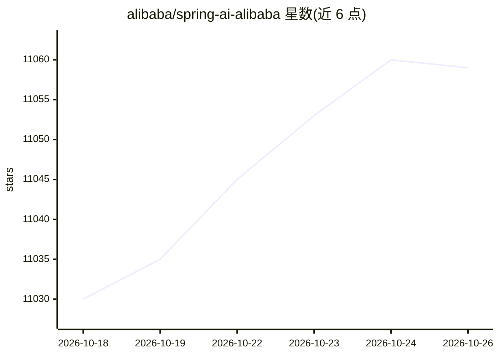

# alibaba/spring-ai-alibaba

⭐ 11,059 · Java · Apache-2.0 · 推送 2026-10-07 · [GitHub](https://github.com/alibaba/spring-ai-alibaba) · [官网](https://java2ai.com) · 组织维护 · 中文 README

**面向 Java 开发者的 Agentic AI 应用开发框架**

阿里巴巴维护的 Java 生产级框架，用于构建 Agentic、Workflow 与多 Agent 应用。包含 Agent Framework（内置上下文工程、Human In The Loop、Sequential/Parallel/Routing/LoopAgent 等工作流）、Graph 底层运行时（持久化、编排、流式）、Admin 一站式可视化 Agent 平台（支持观测、评估、MCP 管理，可对接 Dify 迁移）与 Studio 调试 UI。支持多模态、WebSocket 实时语音 Agent、A2A（Nacos）与多模型接入。要求 JDK 17+ 并提供 LLM API-KEY，通过 Maven starter 依赖与源码方式使用。

## 筛选速览

| 维度 | 判定 | 备注 |
|---|---|---|
| AI 角色 | `ai-ecosystem` | LLM/agent 周边工具 |
| 许可风险 | `permissive` | Apache-2.0 |
| 部署形态 | `None` |  |
| 模型依赖 | — | README 未给出锁定关系 |
| 硬件要求 | — | 无带数字的原话,不猜 |
| 安装摩擦 | `medium` | 含编译或系统依赖之一 |
| 成熟度 | — | 结构信号不足 |

## 能力要点

- 内置 Sequential/Parallel/Routing/LoopAgent 多 Agent 编排模式
- Graph 运行时提供持久化、条件路由与状态管理，可导出 PlantUML/Mermaid
- WebSocket 实时语音 Agent，支持流式音频输入与音频输出
- Admin 可视化平台支持观测、评估与 MCP 管理，可从 Dify DSL 迁移

## 适用场景

- 用 Java 快速开发多 Agent 与工作流应用
- 构建长时运行的有状态 Agent 并做可视化调试与评估
- 通过 A2A 与 Nacos 实现跨服务分布式 Agent 协作

## 场景标签

`Agent 框架` `多智能体` `工作流自动化` `语音 Agent` · 领域:Agent 开发

## 证据(README 行号)

> L11:  A production-ready framework for building Agentic, Workflow, and Multi-agent applications.
> L26: **Spring AI Alibaba Agent Framework** is an agent development framework that can quickly develop agents with built-
> L44: * **Rich Model, Tool and MCP Support**: Leveraging core concepts of Spring AI, supports multiple LLM providers (Das

## 星数曲线

2026-10-18 11,030 → 2026-10-26 11,059（+29）

---
*卡片 v1 · prompt 1.4 · 生成 2026-10-20 · 置信度 high · 依据 README sha `36ad0e58f714` · [字段定义](../../DATASET.md)*
