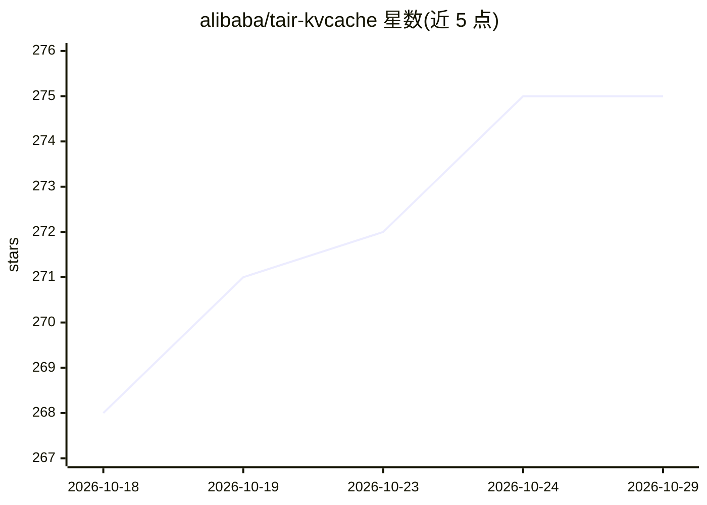

# alibaba/tair-kvcache

⭐ 275 · C++ · Apache-2.0 · 推送 2026-10-28 · [GitHub](https://github.com/alibaba/tair-kvcache) · 组织维护 · 中文 README

**面向 LLM 推理的全局 KVCache 管理与推理模拟系统**

阿里云开源的高性能 KVCache 系统，包含两个组件：Tair KVCache Manager 以集中式部署提供 KVCache 全局元数据管理，支持前缀/滑动窗口等多种匹配逻辑、两阶段写、多存储后端（HF3FS/Mooncake/NFS 等）封装、容量与淘汰管理及访问 trace 回放模拟优化；其 Client/Connector 支持 vLLM、SGLang、RTP-LLM、TRT-LLM 等推理引擎的 KVCache 传输。Tair KVCache HiSim 为 CPU 上的 LLM 推理模拟器，通过回放真实负载 trace 预测 TTFT/TPOT/吞吐等指标，无需 GPU。

## 筛选速览

| 维度 | 判定 | 备注 |
|---|---|---|
| AI 角色 | `ai-ecosystem` | LLM/agent 周边工具 |
| 许可风险 | `permissive` | Apache-2.0 |
| 部署形态 | `None` |  |
| 模型依赖 | — | README 未给出锁定关系 |
| 硬件要求 | — | 无带数字的原话,不猜 |
| 安装摩擦 | `low` | 无编译、无系统依赖或容器化 |
| 成熟度 | — | 结构信号不足 |

## 能力要点

- 集中式全局 KVCache 元数据管理，提供 HTTP/gRPC 服务
- 统一传输库对接 vLLM、SGLang、RTP-LLM、TRT-LLM 等推理引擎
- 兼容 HF3FS、Mooncake、NFS 等多种存储后端
- HiSim 在 CPU 上模拟 LLM 推理，预测误差低于 5%（H20/Qwen3 场景）

## 适用场景

- 为多推理引擎集群做全局 KVCache 管理与容量控制
- 回放 trace 模拟 KVCache 访问以优化容量配置
- 无 GPU 环境下预估推理性能指标（TTFT/TPOT/吞吐）

## 场景标签

`推理引擎` · 领域:训练与推理

## 证据(README 行号)

> L5: Tair KVCache is Alibaba Cloud's high-performance KVCache system designed for Large Language Model (LLM) inference sc
> L9: Tair KVCache Manager is one of the core components of Tair KVCache, designed to provide unified KVCache metadata man
> L50: HiSim is a high-performance CPU-based simulation system for LLM inference. It enables fast, low-cost, and high-fide

## 星数曲线

2026-10-18 268 → 2026-10-29 275（+7）

---
*卡片 v1 · prompt 1.4 · 生成 2026-10-22 · 置信度 high · 依据 README sha `1fa5223d8915` · [字段定义](../../DATASET.md)*
