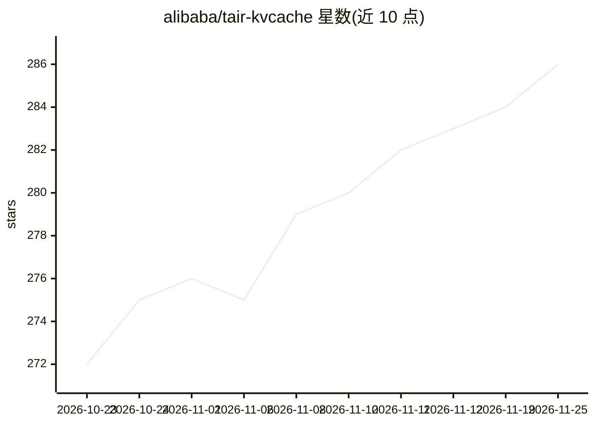

# alibaba/tair-kvcache

⭐ 286 · C++ · Apache-2.0 · 推送 2026-11-23 · [GitHub](https://github.com/alibaba/tair-kvcache) · 组织维护 · 中文 README

**面向 LLM 推理的分布式 KVCache 管理与模拟系统**

面向 LLM 推理场景的 KVCache 系统，包含两个已开源组件：KVCache Manager（KVCM）提供全局 KVCache 元数据管理，将缓存的位置、状态与容量管理从推理实例中分离，支持前缀匹配、两阶段写入、DRAM/SSD 分层存储、多租户配额、主备高可用与 Prometheus 指标；HiSim 提供 CPU 上运行的 LLM 推理模拟，通过回放真实负载 trace 预测 TTFT、TPOT、吞吐等指标，无需 GPU。传输库支持 vLLM、SGLang、RTP-LLM、TRT-LLM 等引擎及 C++/Python/Java 客户端。

## 筛选速览

| 维度 | 判定 | 备注 |
|---|---|---|
| AI 角色 | `ai-ecosystem` | LLM/agent 周边工具 |
| 许可风险 | `permissive` | Apache-2.0 |
| 部署形态 | `None` |  |
| 模型依赖 | local-ok | 支持本地模型 |
| 硬件要求 | — | 无带数字的原话,不猜 |
| 安装摩擦 | `low` | 无编译、无系统依赖或容器化 |
| 成熟度 | — | 结构信号不足 |

## 能力要点

- KVCM 全局元数据管理：跨请求、跨节点复用 KVCache，降低重复计算与 TTFT
- DRAM/SSD 分层存储与异步回收，多租户配额与公平回收策略
- 统一传输库支持 vLLM、SGLang、RTP-LLM、TRT-LLM，提供 C++/Python/Java 客户端
- HiSim 在 CPU 上模拟推理并回放 trace 预测性能指标

## 适用场景

- 为多实例 LLM 推理集群搭建全局 KVCache 复用与容量管理
- 无 GPU 资源时预测不同模型、硬件与引擎配置下的推理性能
- 对缓存淘汰与容量规划做离线 trace 回放与命中率分析

## 场景标签

`推理引擎` · 领域:训练与推理

## 证据(README 行号)

> L5: Tair KVCache is Alibaba Cloud's high-performance KVCache system designed for Large Language Model (LLM) inference sc
> L10: Tair KVCache Manager (KVCM) is a global KVCache metadata management service for LLM inference. It separates KVCache
> L85: A unified transfer library supports KVCache transfer for multiple inference engines and storage backends. It curren

## 星数曲线

2026-10-23 272 → 2026-11-25 286（+14）

---
*卡片 v1 · prompt 1.4 · 生成 2026-11-25 · 置信度 high · 依据 README sha `493db6d3063e` · [字段定义](../../DATASET.md)*
