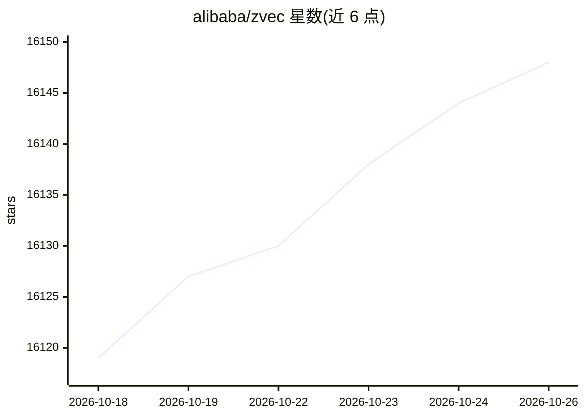

# alibaba/zvec

⭐ 16,148 · C++ · Apache-2.0 · 推送 2026-10-22 · [GitHub](https://github.com/alibaba/zvec) · [官网](https://zvec.org) · 组织维护 · 中文 README

**面向应用开发者的嵌入式向量数据库，提供进程内相似度检索**

以进程内库形式运行的向量数据库，直接嵌入应用程序，无需独立服务。支持稠密与稀疏向量、多种索引类型（内存到磁盘）、关键词全文检索，并可在单条查询中融合向量相似度、全文与结构化过滤。通过预写日志（WAL）保证持久化，支持多进程并发读。官方提供 Python/Node.js/Go/Rust/Dart SDK，及 zvec-grep 搜索 CLI 与 Zvec Studio 可视化工具。预编译二进制覆盖 Linux/macOS/Windows/Android/iOS。

## 筛选速览

| 维度 | 判定 | 备注 |
|---|---|---|
| AI 角色 | `ai-ecosystem` | LLM/agent 周边工具 |
| 许可风险 | `permissive` | Apache-2.0 |
| 部署形态 | `library` | 以包/库形式分发 |
| 模型依赖 | — | README 未给出锁定关系 |
| 硬件要求 | — | 无带数字的原话,不猜 |
| 安装摩擦 | `low` | 无编译、无系统依赖或容器化 |
| 成熟度 | — | 结构信号不足 |

## 动量与使用信号

- 维护:`active` — 距上次 push 2.0 天,年发版 12,35 位贡献者
- 涨星:近 1 天 **+4**(自 20261016 起算)
- 安装:pypi 包 `zvec` 月下载 30,918
- 平台:WINDOWS / MACOS / LINUX / ANDROID / IOS · 协议:—

## 能力要点

- 稠密+稀疏向量、多向量查询，索引类型覆盖内存到磁盘
- 混合检索：向量相似度、全文检索与结构化过滤单查询融合
- WAL 持久化与多进程并发读取
- 提供 Python/Node.js/Go/Rust/Dart 官方 SDK

## 适用场景

- 为本地或边缘应用嵌入相似度搜索能力
- 构建 RAG 应用的向量与全文混合检索层
- 为 AI agent 提供本地记忆/工作区搜索后端

## 场景标签

`向量数据库` · 领域:知识与检索

## 证据(README 行号)

> L22: **Zvec** is an open-source, in-process vector database — lightweight, lightning-fast, and designed to embed directl
> L28: > - **ReMe integration**: zvec is now a file store backend in ReMe, the memory management kit for agents, providing
> L43: - **Hybrid Search**: Fuse vector similarity, full-text search, and structured filters in a single query for precise

## 星数曲线

2026-10-18 16,119 → 2026-10-26 16,148（+29）

---
*卡片 v1 · prompt 1.4 · 生成 2026-10-18 · 置信度 high · 依据 README sha `ad14580bd246` · [字段定义](../../DATASET.md)*
