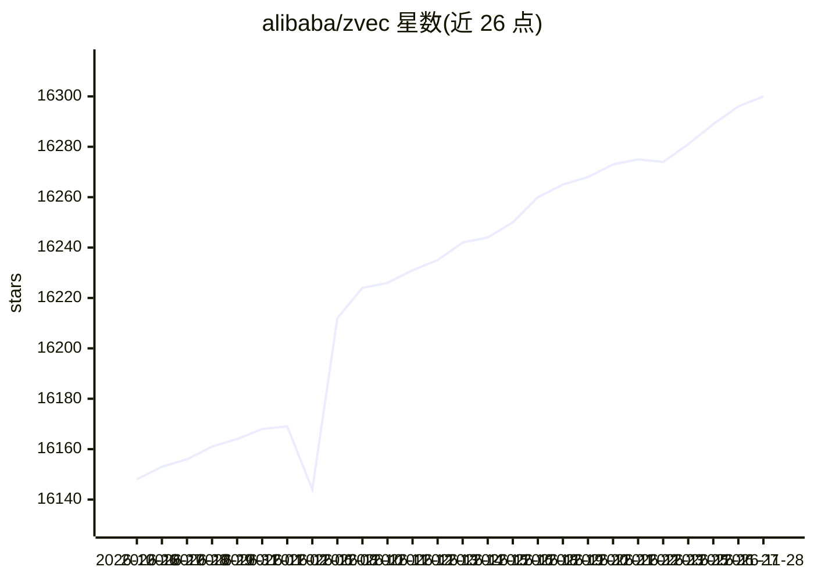

# alibaba/zvec

⭐ 16,300 · C++ · Apache-2.0 · 推送 2026-11-27 · [GitHub](https://github.com/alibaba/zvec) · [官网](https://zvec.org) · 组织维护 · 中文 README

**嵌入式进程内向量数据库，面向应用开发者提供相似度检索**

以库形式直接嵌入应用的向量数据库，无需独立服务进程。提供稠密/稀疏向量索引、原生全文检索、以及向量相似度+全文+结构化过滤的混合查询；支持从内存到磁盘的多种索引类型（HNSW、IVF、DiskANN、RaBitQ 等）、WAL 持久化与多进程并发读。提供 Python/Node.js/Go/Rust/Java/Dart 六种语言的官方 SDK，覆盖 Linux/macOS/Windows/Android/iOS 平台。Python 需 64 位 3.10–3.14。

## 筛选速览

| 维度 | 判定 | 备注 |
|---|---|---|
| AI 角色 | `ai-ecosystem` | LLM/agent 周边工具 |
| 许可风险 | `permissive` | Apache-2.0 |
| 部署形态 | `library` | 以包/库形式分发 |
| 模型依赖 | — | README 未给出锁定关系 |
| 硬件要求 | — | 无带数字的原话,不猜 |
| 安装摩擦 | `medium` | 含编译或系统依赖之一 |
| 成熟度 | — | 结构信号不足 |

## 动量与使用信号

- 维护:`active` — 距上次 push 2.0 天,年发版 12,35 位贡献者
- 涨星:近 1 天 **+4**(自 20261016 起算)
- 安装:pypi 包 `zvec` 月下载 30,918
- 平台:WINDOWS / MACOS / LINUX / ANDROID / IOS · 协议:—

## 能力要点

- 进程内嵌入运行，纯本地、无服务、无配置
- 稠密+稀疏向量与混合检索（向量+FTS+过滤）
- WAL 持久化，进程崩溃或断电数据不丢失
- 六语言官方 SDK，覆盖桌面、服务器与移动端

## 适用场景

- 为 RAG 应用提供本地向量存储与检索
- 为 Agent 记录长期记忆数据
- 在边缘设备或移动端离线运行语义搜索
- 关键字与向量混合检索代码或文档

## 场景标签

`向量数据库` `RAG` `语义搜索` `Agent 记忆` · 领域:Agent 开发

## 证据(README 行号)

> L20: **Zvec** is an open-source, in-process vector database — lightweight, lightning-fast, and designed to embed directl
> L41: - **Hybrid Search**: Fuse vector similarity, full-text search, and structured filters in a single query for precise
> L44: - **Runs Anywhere**: As an in-process library, Zvec runs wherever your code runs — notebooks, servers, CLI tools, o

## 星数曲线

2026-10-26 16,148 → 2026-11-28 16,300（+152）

---
*卡片 v1 · prompt 1.4 · 生成 2026-11-23 · 置信度 high · 依据 README sha `7164f075b921` · [字段定义](../../DATASET.md)*
