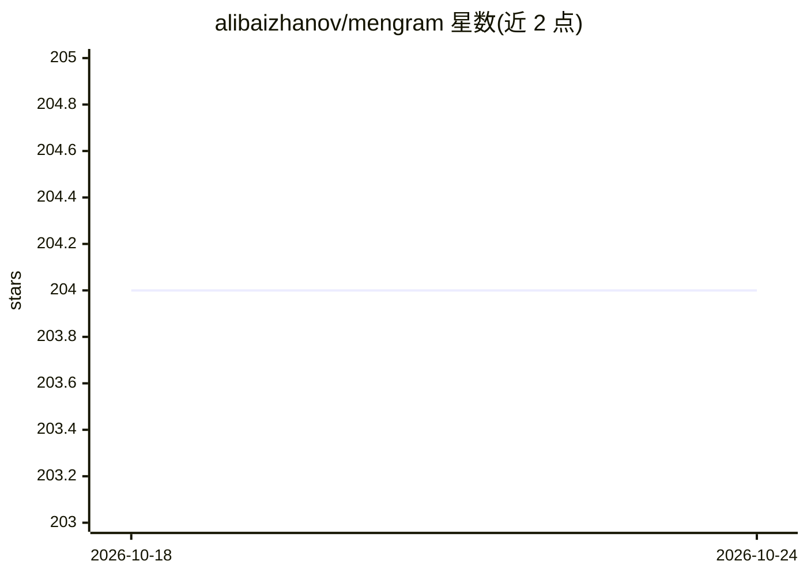

# alibaizhanov/mengram

⭐ 204 · Python · Apache-2.0 · 推送 2026-09-16 · [GitHub](https://github.com/alibaizhanov/mengram) · [官网](https://mengram.io) · 个人维护

**给 AI agent 的记忆层：语义/情景/程序性记忆与失败演化**

面向 AI agent 开发者的记忆服务：以 Python/JS SDK、REST API 与 MCP server 形式接入，存储三类记忆（语义事实、情景事件、程序性工作流），其中程序可从失败反馈自动演化版本并记录被违反的前提假设。提供内置 RAG 问答（Cohere Chat + 引用）、认知画像生成 system prompt、PDF/DOCX 文件上传、ChatGPT/Obsidian/Claude Code 历史导入，以及 Claude Code/Codex/Cursor 的 hooks 自动保存与召回。云端免费 key 即用，另支持无账号的本地 Markdown 文件夹模式（自带 LLM provider）。

## 筛选速览

| 维度 | 判定 | 备注 |
|---|---|---|
| AI 角色 | `ai-ecosystem` | LLM/agent 周边工具 |
| 许可风险 | `permissive` | Apache-2.0 |
| 部署形态 | `desktop` | 安装包/桌面程序 |
| 模型依赖 | local-ok | 支持本地模型 |
| 硬件要求 | — | 无带数字的原话,不猜 |
| 安装摩擦 | `low` | 无编译、无系统依赖或容器化 |
| 成熟度 | — | 结构信号不足 |

## 能力要点

- 三类记忆：语义/情景/程序性，程序可从失败自动演化并记录前提假设
- Claude Code/Codex/Cursor 生命周期 hooks：自动保存、召回、compaction 前后状态恢复
- 任务卡 mengram resume：跨会话/跨机器续接任务上下文
- 无账号本地模式：Markdown 文件夹存储 + 自选 provider（anthropic/openai/ollama）

## 适用场景

- 给编码 agent 加持久记忆，/clear 或 compaction 后不丢上下文
- 在 LangChain/CrewAI 构建的多 agent 中共享语义与情景记忆
- 从 ChatGPT/Obsidian 导入历史数据消除冷启动
- 断点续接：第二天或换台机器继续昨天的任务分支

## 场景标签

`Agent 记忆` `RAG` · 领域:Agent 开发

## 证据(README 行号)

> L3: ### Give your AI agents memory that actually learns
> L111: Every AI memory tool stores facts. Mengram stores **3 types of memory** — and procedures **evolve when they fail**

## 星数曲线

2026-10-18 204 → 2026-10-24 204（+0）

---
*卡片 v1 · prompt 1.4 · 生成 2026-10-22 · 置信度 high · 依据 README sha `42be6a23e235` · [字段定义](../../DATASET.md)*
