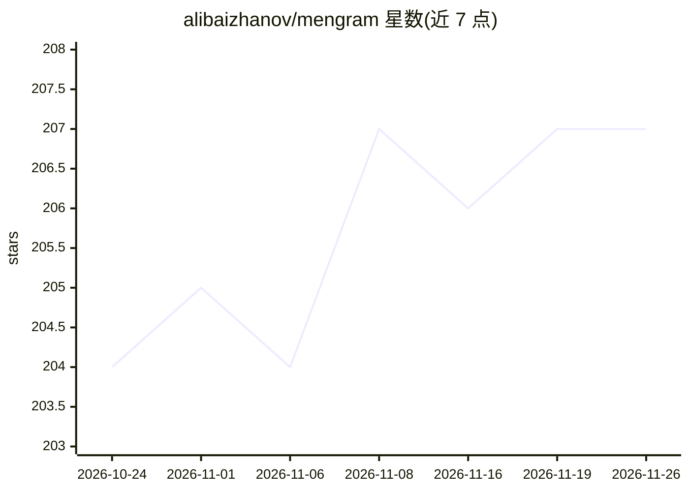

# alibaizhanov/mengram

⭐ 207 · Python · Apache-2.0 · 推送 2026-11-09 · [GitHub](https://github.com/alibaizhanov/mengram) · [官网](https://mengram.io) · 个人维护

**为 AI agent 提供语义/情景/程序三类持久记忆的服务**

Mengram 是面向 AI agent 的记忆层：存储语义记忆（事实/偏好）、情景记忆（事件/决策）与程序记忆（工作流），程序记忆可在用户报告失败后自动迭代出新版本并记录失效前提。提供云 API（含免费 key）、Python/JS SDK、REST API，以及完全本地的文件夹记忆模式（Markdown 存储、自备模型 key）。通过 MCP server 与 CLI hooks 集成 Claude Code、Cursor、Codex 等工具，支持会话恢复、历史导入与 23 语言多语言检索。Apache 2.0 许可。

## 筛选速览

| 维度 | 判定 | 备注 |
|---|---|---|
| AI 角色 | `ai-ecosystem` | LLM/agent 周边工具 |
| 许可风险 | `permissive` | Apache-2.0 |
| 部署形态 | `desktop` | 安装包/桌面程序 |
| 模型依赖 | local-ok | 支持本地模型 |
| 硬件要求 | — | 无带数字的原话,不猜 |
| 安装摩擦 | `low` | 无编译、无系统依赖或容器化 |
| 成熟度 | — | 结构信号不足 |

## 能力要点

- 三类记忆：semantic、episodic、procedural，程序记忆可随失败自动演化版本
- 本地文件夹记忆模式：Markdown 存储、无需账号、自备模型 key
- MCP server 与 CLI hooks：跨 Claude Code/Cursor/Codex 共享同一记忆
- m.ask() 返回带引用的合成答案（Cohere 多语言嵌入与重排）

## 适用场景

- 让 Claude Code 会话在 /clear 与压缩后保留上下文
- 团队在多机/多 agent 之间接续未完成的任务
- 把 ChatGPT 导出与 Obsidian 库导入为 agent 记忆

## 场景标签

`Agent 记忆` · 领域:Agent 开发

## 证据(README 行号)

> L3: ### Give your AI agents memory that actually learns
> L111: Every AI memory tool stores facts. Mengram stores **3 types of memory** — and procedures **evolve when they fail**
> L102: mengram server --memory ./memory                                         # MCP for Claude Desktop, Cursor, any cli

## 星数曲线

2026-10-24 204 → 2026-11-26 207（+3）

---
*卡片 v1 · prompt 1.4 · 生成 2026-11-25 · 置信度 high · 依据 README sha `e7347124bdd4` · [字段定义](../../DATASET.md)*
