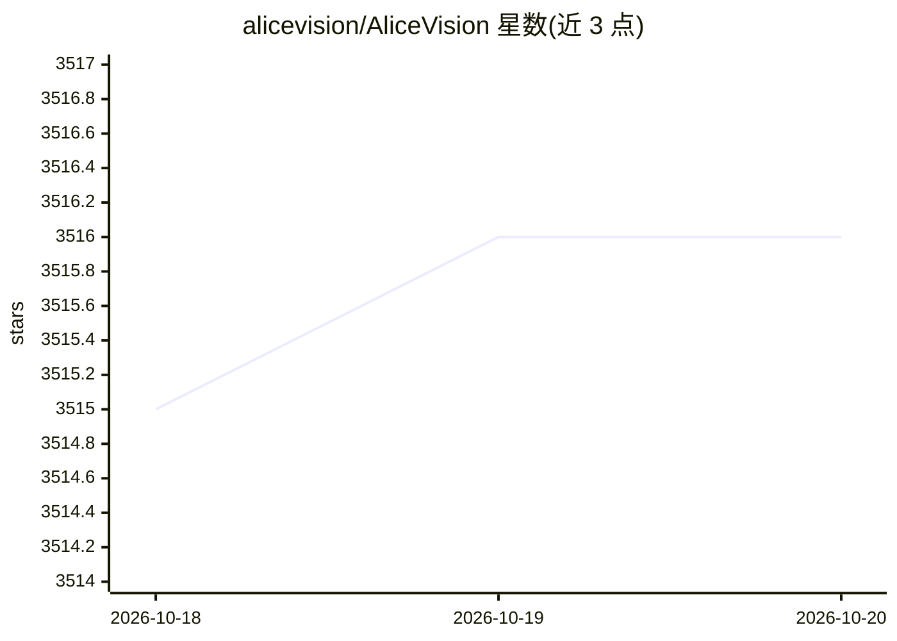

# alicevision/AliceVision

⭐ 3,516 · C++ · NOASSERTION · 推送 2026-10-19 · [GitHub](https://github.com/alicevision/AliceVision) · [官网](https://alicevision.org) · 组织维护

**摄影测量计算机视觉框架：从照片重建 3D 场景与相机追踪**

提供 3D 重建与相机追踪算法的摄影测量计算机视觉框架，由学界与产业合作开发，目标是提供可测试、可分析、可复用的计算机视觉算法基础。从无序照片或视频推断场景几何（摄影测量）。本体为 C++ 源码工程，需按 INSTALL.md 自行编译；实际运行管线通过配套的 Meshroom（图形界面与命令行）启动，Meshroom 引擎与命令行不依赖 Qt。许可证为 MPLv2。

## 筛选速览

| 维度 | 判定 | 备注 |
|---|---|---|
| AI 角色 | `ai-native` | 本体是模型或模型工具 |
| 许可风险 | `none` | NOASSERTION |
| 部署形态 | `None` |  |
| 模型依赖 | — | README 未给出锁定关系 |
| 硬件要求 | — | 无带数字的原话,不猜 |
| 安装摩擦 | `low` | 无编译、无系统依赖或容器化 |
| 成熟度 | — | 结构信号不足 |

## 能力要点

- 3D 重建与相机追踪算法库
- 从无序照片或视频推断场景几何
- 管线经由 Meshroom 的 UI 与命令行运行，支持 Python 脚本定制

## 适用场景

- 用照片集生成 3D 重建结果
- 影视/视觉特效制作中的相机追踪
- 基于管线做计算机视觉算法研究与复用

## 场景标签

`图像视频处理` · 领域:感知与多模态

## 证据(README 行号)

> L3: AliceVision is a Photogrammetric Computer Vision Framework which provides a 3D Reconstruction and Camera Tracking al
> L15: Photogrammetry is the science of making measurements from photographs.
> L16: It infers the geometry of a scene from a set of unordered photographies or videos.

## 星数曲线

2026-10-18 3,515 → 2026-10-20 3,516（+1）

---
*卡片 v1 · prompt 1.4 · 生成 2026-10-20 · 置信度 high · 依据 README sha `58e36e5c03ba` · [字段定义](../../DATASET.md)*
