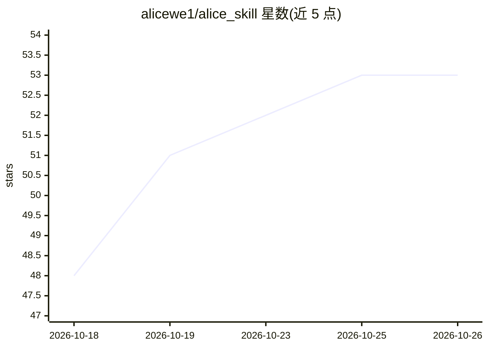

# alicewe1/alice_skill

⭐ 53 · Python · GPL-3.0 · 推送 2026-09-29 · [GitHub](https://github.com/alicewe1/alice_skill) · 个人维护 · 中文 README

**AI 编程 agent 的 drop-in 攻防技能包（423 模块，六类）**

自包含的技能集成文件夹树，放入任意 Agent 客户端（codex/claude/cursor 等 8 种）的 skills 目录即可使用。包含一个总控菜单、六个路由技能（卡密破解/逆向/Web 渗透/游戏攻防/AI 安全测试/技能管理）和 423 个技能模块正文，设计目标是让 Agent 用最少 token 定位所需技能正文。附迁移自检、提示词注入、吸收新技能等脚本命令。README 声明仅限安全研究、CTF 与已授权资产测试用途，GPL-3.0 许可。

## 筛选速览

| 维度 | 判定 | 备注 |
|---|---|---|
| AI 角色 | `ai-knowledge` | 知识聚合/清单类 |
| 许可风险 | `viral` | GPL-3.0 |
| 部署形态 | `None` |  |
| 模型依赖 | — | README 未给出锁定关系 |
| 硬件要求 | — | 无带数字的原话,不猜 |
| 安装摩擦 | `low` | 无编译、无系统依赖或容器化 |
| 成熟度 | — | 结构信号不足 |

## 能力要点

- 423 个技能模块按六类路由（crack/reverse/pentest/game/ai/assist）
- 支持 codex/claude/cursor/workbuddy 等 8 种客户端的 skills 目录放置
- 迁移自检脚本刷新内嵌路径并四点自检
- 提示词注入幂等、自动备份、提供回滚命令

## 适用场景

- 把攻防技能库整包放进 AI 编程客户端按需调用
- CTF 竞赛与授权安全测试中扩展 Agent 能力
- 用吸收新技能指令扩充自己的技能库并重建菜单

## 场景标签

`网络安全` · 领域:学习与行业

## 证据(README 行号)

> L29: `alice_skill` 是一套**自包含的技能集成包**。它不是一个程序，而是一棵可以直接丢进客户端技能目录的文件夹树：
> L32: - **六个路由技能**（`alice-crack` / `alice-reverse` / `alice-pentest` / `alice-game` / `alice-ai` / `alice-assist`）—— 每类一页

## 星数曲线

2026-10-18 48 → 2026-10-26 53（+5）

---
*卡片 v1 · prompt 1.4 · 生成 2026-10-24 · 置信度 high · 依据 README sha `8eecdda62f78` · [字段定义](../../DATASET.md)*
