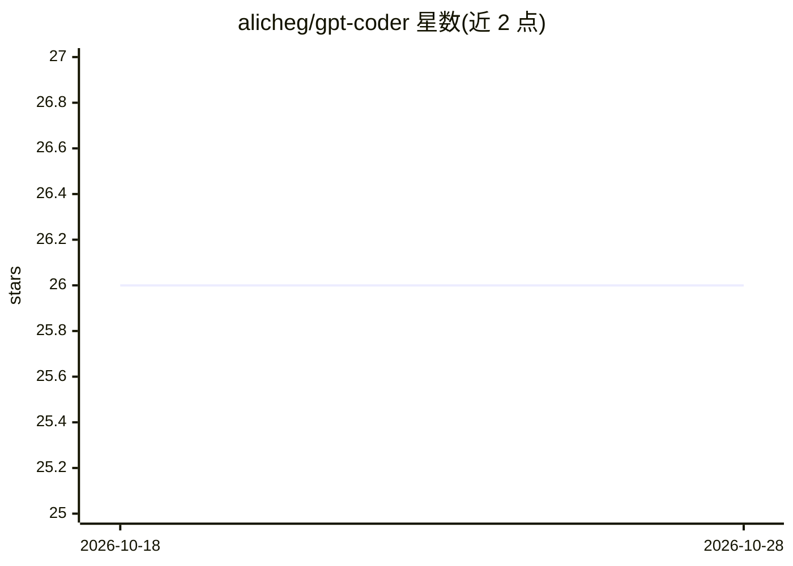

# alicheg/gpt-coder

⭐ 26 · Python · MIT · 推送 2025-12-25 · [GitHub](https://github.com/alicheg/gpt-coder) · 个人维护

**调用 OpenAI GPT 生成并自动求解编程题的命令行工具**

Python 编写的自动化代码生成工具：调用 OpenAI GPT API 生成编程挑战题目及其解法，从题目中解析测试用例，并通过自我监督的循环对解法进行迭代精炼、编译与测试，直到满足预期标准。面向需要在终端中生成和求解算法题的开发者。使用需配置 OpenAI API key，通过克隆仓库、安装 requirements.txt 依赖后运行 src/main.py。

## 筛选速览

| 维度 | 判定 | 备注 |
|---|---|---|
| AI 角色 | `ai-native` | 本体是模型或模型工具 |
| 许可风险 | `permissive` | MIT |
| 部署形态 | `library` | 以包/库形式分发 |
| 模型依赖 | — | README 未给出锁定关系 |
| 硬件要求 | — | 无带数字的原话,不猜 |
| 安装摩擦 | `low` | 无编译、无系统依赖或容器化 |
| 成熟度 | — | 结构信号不足 |

## 能力要点

- GPT 生成编程挑战与对应解法
- 自动精炼循环直至满足预期标准
- 解法的编译、执行与测试用例验证
- 测试用例自动解析

## 适用场景

- 自动生成算法编程题
- 生成并通过测试验证题目解法
- 研究 GPT 自我监督式代码精炼流程

## 场景标签

`代码生成` · 领域:编码与开发

## 证据(README 行号)

> L7: This repository contains An automated python code generation tool utilizing OpenAI's GPT API, to produce code challe
> L11: - Code challenge generation: Generate code challenges using GPT models.

## 星数曲线

2026-10-18 26 → 2026-10-28 26（+0）

---
*卡片 v1 · prompt 1.4 · 生成 2026-10-26 · 置信度 mid · 依据 README sha `c3305d029981` · [字段定义](../../DATASET.md)*
