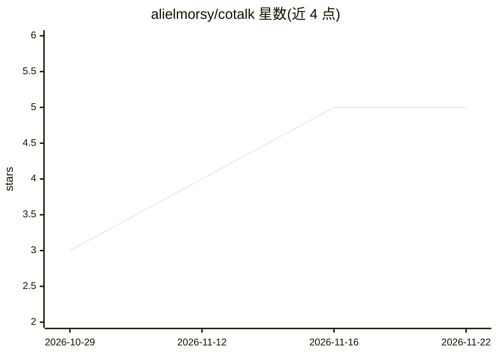

# alielmorsy/cotalk

⭐ 5 · JavaScript · MIT · 推送 2026-10-21 · [GitHub](https://github.com/alielmorsy/cotalk) · 个人维护

**本地多 agent 会话协调工具：共享契约、互问与任务交接**

在单机本地运行的轻量 daemon 与插件集合，让 Claude Code、Antigravity（agy）与 Codex 会话之间共享键控契约与架构决策、互发问题、委派任务。机制包括 Board 键值通知、Requests 状态流转（open→claimed→done）、human-in-the-loop 问题路由到用户终端或 Web 面板、headless agy 后台 worker，以及 127.0.0.1:7878 的实时 Web Dashboard。数据存于本地 SQLite，运行不外发数据。需 Node.js 22.13+ 与至少一个 agent CLI。

## 筛选速览

| 维度 | 判定 | 备注 |
|---|---|---|
| AI 角色 | `ai-ecosystem` | LLM/agent 周边工具 |
| 许可风险 | `permissive` | MIT |
| 部署形态 | `library` | 以包/库形式分发 |
| 模型依赖 | — | README 未给出锁定关系 |
| 硬件要求 | — | 无带数字的原话,不猜 |
| 安装摩擦 | `low` | 无编译、无系统依赖或容器化 |
| 成熟度 | — | 结构信号不足 |

## 能力要点

- Board 共享键控契约与决策，条目变更自动通知相关 agent
- 问题可直接路由给用户，经终端或 Web 面板回答
- 支持 headless agy 后台 worker 与 Claude 主导的工作流
- Web Dashboard 实时监控会话、请求、worker 与日志

## 适用场景

- 多个 coding agent 分工开发不同服务并互相咨询
- 让 Claude 调度后台 agy worker 自动完成任务
- 人工介入回答 agent 提出的问题而不消耗 agent token

## 场景标签

`多智能体` `编码 Agent` · 领域:Agent 开发

## 证据(README 行号)

> L5: Lets Claude Code, Antigravity (`agy`), and Codex sessions share contracts and decisions, ask each other questions, a
> L3: Multi-agent coordination on your local machine.

## 星数曲线

2026-10-29 3 → 2026-11-22 5（+2）

---
*卡片 v1 · prompt 1.4 · 生成 2026-11-21 · 置信度 high · 依据 README sha `967745272468` · [字段定义](../../DATASET.md)*
