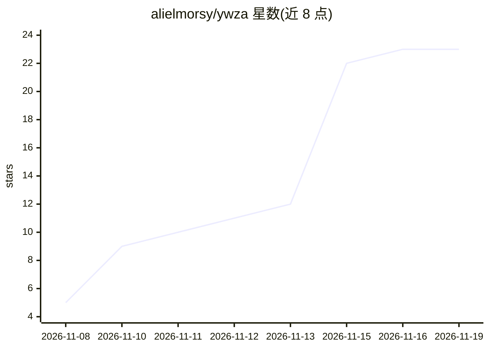

# alielmorsy/ywza

⭐ 23 · Rust · AGPL-3.0 · 推送 2026-11-15 · [GitHub](https://github.com/alielmorsy/ywza) · 个人维护

**远程操控自己电脑的 computer-use agent，自带模型接入**

在被控 PC 上以后台 agent 形式运行的 computer-use 工具：让 AI 模型查看窗口元素、在任意应用中点击输入、操作已打开的终端。其他设备通过 6 位配对码点对点直连，无需账号和自建服务器，可经公共中继跨网络访问。模型自选，任何兼容 OpenAI chat API 的服务（含本地 Ollama、LM Studio）均可。以编号元素列表代替逐步截图以降低 token 用量，需要时可请求截图；提供 OCR 引擎选项、密码保管库、token 用量回执与 MCP 服务器。Windows 完整支持，Linux 仅 X11，macOS 不支持。

## 筛选速览

| 维度 | 判定 | 备注 |
|---|---|---|
| AI 角色 | `ai-native` | 本体是模型或模型工具 |
| 许可风险 | `viral` | AGPL-3.0 |
| 部署形态 | `desktop` | 安装包/桌面程序 |
| 模型依赖 | local-ok | 支持本地模型 |
| 硬件要求 | — | 无带数字的原话,不猜 |
| 安装摩擦 | `medium` | 含编译或系统依赖之一 |
| 成熟度 | — | 结构信号不足 |

## 能力要点

- 窗口元素编号描述代替逐步截图，降低 token 消耗
- 6 位配对码的点对点直连，无账号无服务器，支持跨网络公共中继
- 兼容任何 OpenAI chat API 模型，含本地 Ollama 与 LM Studio
- 提供 MCP 服务器（支持 Claude Code、Codex、Antigravity 插件）与密码保管库

## 适用场景

- 远程让 AI 代为操作家里或办公室的电脑
- 通过手机或其他设备对话式驱动本机完成任务
- 在 MCP 客户端（如 Claude Code）中控制本机与多台已配对设备

## 场景标签

`GUI 自动化` · 领域:效率与自动化

## 证据(README 行号)

> L5:  Let an AI model use your PC, from anywhere.
> L14: ywza lets an AI model use your computer the way you do. It can look at your windows, click and type in any app, and
> L20: anything that speaks the OpenAI chat API works, including local ones like Ollama and LM Studio.

## 星数曲线

2026-11-08 5 → 2026-11-19 23（+18）

---
*卡片 v1 · prompt 1.4 · 生成 2026-11-18 · 置信度 high · 依据 README sha `4d6b0ed28f62` · [字段定义](../../DATASET.md)*
