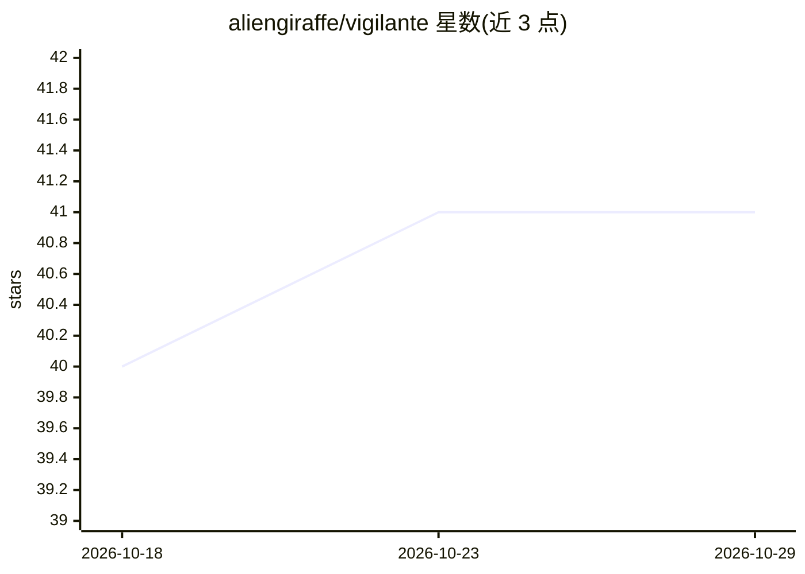

# aliengiraffe/vigilante

⭐ 41 · Go · Apache-2.0 · 推送 2026-10-26 · [GitHub](https://github.com/aliengiraffe/vigilante) · 个人维护

**面向编码 agent 的沙箱优先编排层：issue 到 PR 的受控流水线**

Go 实现的本地编排守护服务：监控绑定 GitHub 远端的仓库，读取符合条件的 issue，为每个任务创建独立 git worktree 与分支，在 worktree 中启动受支持的编码 agent CLI（claude/codex/gemini/opencode），通过 issue 评论、本地会话状态与 PR 追踪进度，并提供 resume/redispatch/cleanup 恢复流程。支持 GitHub API 限额感知、fork 模式与不依赖 LLM 的 Node.js 包加固扫描。目前仅 GitHub 为完整实现的后端；容器化沙箱为规划中。

## 筛选速览

| 维度 | 判定 | 备注 |
|---|---|---|
| AI 角色 | `ai-ecosystem` | LLM/agent 周边工具 |
| 许可风险 | `permissive` | Apache-2.0 |
| 部署形态 | `desktop` | 安装包/桌面程序 |
| 模型依赖 | locked-api |  |
| 硬件要求 | — | 无带数字的原话,不猜 |
| 安装摩擦 | `low` | 无编译、无系统依赖或容器化 |
| 成熟度 | — | 结构信号不足 |

## 能力要点

- 每个 issue 独立 git worktree 隔离执行
- 支持 claude/codex/gemini/opencode 四种编码 agent CLI，可按标签路由模型
- resume/redispatch/cleanup 一等公民恢复流程与 GitHub API 限额感知
- fork 模式与不依赖 LLM 的 Node.js 依赖加固扫描

## 适用场景

- 把 GitHub issue 自动转成受控的 PR 流水线
- 隔离运行编码 agent，避免其误读文件或误用凭据
- 通过 issue 评论与会话状态审计 agent 工作全程

## 场景标签

`Agent 框架` `编码 Agent` · 领域:Agent 开发

## 证据(README 行号)

> L11: `vigilante` is a sandbox-first orchestration layer for coding agents.
> L15: It is not the model itself. Vigilante schedules work, prepares isolated worktrees, launches a supported coding-agen
> L48: - **Provider-neutral orchestration.** Works with supported headless coding-agent CLIs including `codex`, `claude`, 

## 星数曲线

2026-10-18 40 → 2026-10-29 41（+1）

---
*卡片 v1 · prompt 1.4 · 生成 2026-10-25 · 置信度 high · 依据 README sha `4d1b78db768d` · [字段定义](../../DATASET.md)*
