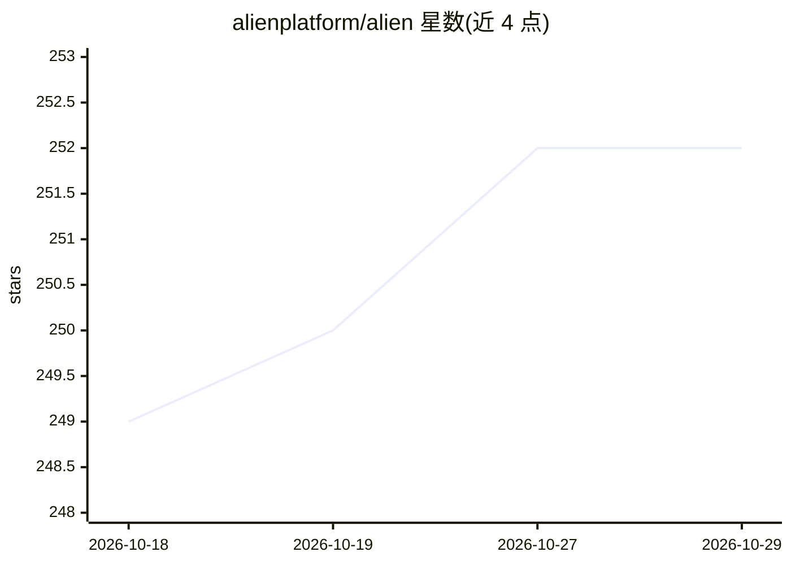

# alienplatform/alien

⭐ 252 · Rust · NOASSERTION · 推送 2026-10-28 · [GitHub](https://github.com/alienplatform/alien) · [官网](https://alien.dev) · 组织维护

**把产品数据面部署到客户云/本地环境的托管自托管基础设施**

面向需要在客户控制的环境（AWS/GCP/Azure、Kubernetes 或离线站点）运行产品组件的开发团队：通过 CLI 与可自托管或由 alien.dev 托管的 manager，实现发布自动下发、日志遥测回传、隧道调用与远程命令。支持 Push（客户授予受限角色）与 Pull（Operator 经出站连接拉取）两种部署模式，资源声明自动映射到各平台原生服务，并提供离线环境的同步包与最小权限模型。

## 筛选速览

| 维度 | 判定 | 备注 |
|---|---|---|
| AI 角色 | `ai-enhanced` | 去掉 AI 部分产品仍成立 |
| 许可风险 | `none` | NOASSERTION |
| 部署形态 | `self-host` | docker 或自建部署 |
| 模型依赖 | — | README 未给出锁定关系 |
| 硬件要求 | — | 无带数字的原话,不猜 |
| 安装摩擦 | `low` | 无编译、无系统依赖或容器化 |
| 成熟度 | — | 结构信号不足 |

## 能力要点

- Push/Pull 两种部署模式，Pull 模式无需入站连接
- 发布渠道管理与 Operator 自更新
- OpenTelemetry 日志转发到 Datadog/Grafana 等后端
- 离线（air-gapped）环境经文件夹同步更新与回传日志

## 适用场景

- 把服务部署到客户的 Kubernetes 集群或云账号并持续更新
- 后端经隧道调用客户网络内的容器与远程命令
- 在无外网的站点通过同步文件夹交付与升级应用

## 场景标签

 · 领域:云基础设施/部署

## 证据(README 行号)

> L7: **Infrastructure for software outside your cloud.**
> L9: Some of your product has to run where you don't control the infrastructure: a customer's AWS, Google Cloud or Azure 
> L134: - remote-worker-ts: tool execution inside the customer's cloud for an AI agent

## 星数曲线

2026-10-18 249 → 2026-10-29 252（+3）

---
*卡片 v1 · prompt 1.4 · 生成 2026-10-22 · 置信度 high · 依据 README sha `c714243c6335` · [字段定义](../../DATASET.md)*
