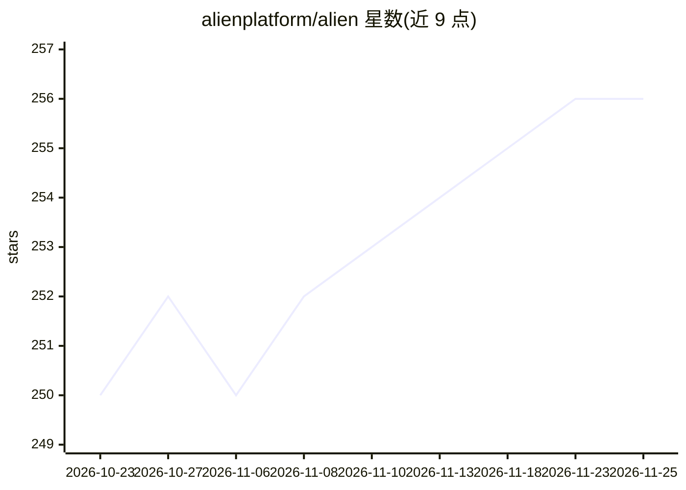

# alienplatform/alien

⭐ 256 · Rust · NOASSERTION · 推送 2026-11-24 · [GitHub](https://github.com/alienplatform/alien) · [官网](https://alien.dev) · 组织维护

**面向客户云外环境部署软件的基础设施与 CLI**

一套部署到客户自有环境（AWS/GCP/Azure 账户、Kubernetes 集群、离线站点）的数据平面基础设施：manager 作为控制平面中枢，通过 push（云 API 部署）或 pull（Operator 出站连接）两种方式交付更新，提供自动发布、日志回传、远程命令调用，支持最小权限派生与气隙环境的文件夹同步更新。Rust CLI 与 TypeScript SDK 驱动，manager 可自托管或使用 alien.dev 托管。

## 筛选速览

| 维度 | 判定 | 备注 |
|---|---|---|
| AI 角色 | `ai-enhanced` | 去掉 AI 部分产品仍成立 |
| 许可风险 | `none` | NOASSERTION |
| 部署形态 | `self-host` | docker 或自建部署 |
| 模型依赖 | — | README 未给出锁定关系 |
| 硬件要求 | — | 无带数字的原话,不猜 |
| 安装摩擦 | `low` | 无编译、无系统依赖或容器化 |
| 成熟度 | — | 结构信号不足 |

## 能力要点

- push/pull 两种部署模式，pull 模式仅需出站连接
- 气隙环境通过 alien-deploy sync 在断网两侧同步签名更新与报告
- 从 stack 定义派生最小权限，管理权限不含数据访问
- 同一资源定义映射到 S3/GCS/Azure Blob/MinIO/Ceph 等平台原生服务

## 适用场景

- 把服务交付到客户的 Kubernetes 集群或云账户
- 向完全断网的站点分发与回传软件更新
- 在客户内网运行 API 或数据连接器而不共享凭证

## 场景标签

 · 领域:云基础设施/部署运维

## 证据(README 行号)

> L9: Some of your product has to run where you don't control the infrastructure: a customer's AWS, Google Cloud or Azure 
> L125: - remote-worker-ts: tool execution inside the customer's cloud for an AI agent

## 星数曲线

2026-10-23 250 → 2026-11-25 256（+6）

---
*卡片 v1 · prompt 1.4 · 生成 2026-11-25 · 置信度 mid · 依据 README sha `f7b065237a18` · [字段定义](../../DATASET.md)*
