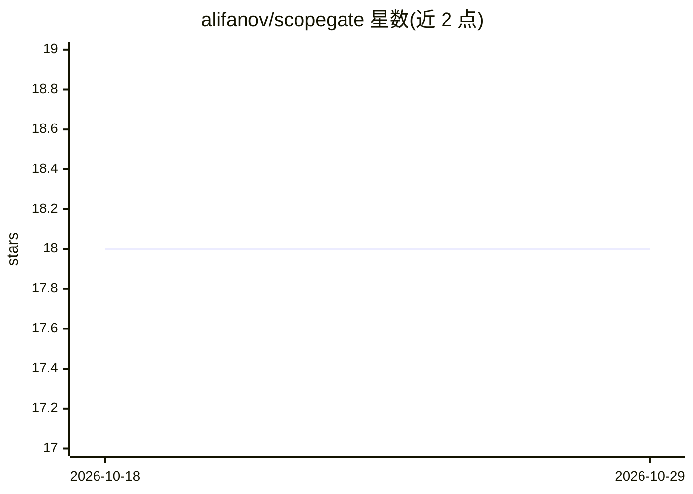

# alifanov/scopegate

⭐ 18 · TypeScript · MIT · 推送 2026-10-26 · [GitHub](https://github.com/alifanov/scopegate) · [官网](https://scopegate.dev) · 个人维护

**AI 代理的细粒度权限网关，按动作粒度下发 MCP 端点**

部署在 AI 代理与所连服务（自有或客户的 Gmail、Slack、Notion、Jira 等 27 个提供商）之间的访问代理层：每个 OAuth 连接可逐动作勾选权限（如 gmail:read_emails），生成只能调用允许动作的 MCP 端点；所有调用记录审计日志，端点密钥可一键吊销而不影响底层连接，令牌以 AES-256-GCM 加密存储且不出系统。技术栈为 Next.js/TypeScript/PostgreSQL，提供 docker compose 一键自托管，与托管云版功能一致。

## 筛选速览

| 维度 | 判定 | 备注 |
|---|---|---|
| AI 角色 | `ai-ecosystem` | LLM/agent 周边工具 |
| 许可风险 | `permissive` | MIT |
| 部署形态 | `self-host` | docker 或自建部署 |
| 模型依赖 | — | README 未给出锁定关系 |
| 硬件要求 | — | 无带数字的原话,不猜 |
| 安装摩擦 | `low` | 无编译、无系统依赖或容器化 |
| 成熟度 | — | 结构信号不足 |

## 能力要点

- 逐动作粒度权限，替代直接下发完整 OAuth scope
- 27 个提供商的连接注册表（Google Workspace、Slack、Notion、Jira、Stripe 等）
- 审计日志与端点密钥一键吊销
- 自托管版与云版功能完全一致

## 适用场景

- 给客户代理分配只能读 Gmail 不能发信的受限访问
- 按项目审计 AI 代理调用过哪些工具及结果
- 不向代理暴露原始令牌的前提下接入 SaaS 服务

## 场景标签

 · 领域:AI 代理基础设施/安全网关

## 证据(README 行号)

> L5: ScopeGate sits between your agents and the accounts they reach — yours or your
> L7: and hand it an MCP endpoint that can do nothing else. Every call is logged; one
> L122: 5. **Use the MCP URL** — plug the endpoint URL into any MCP-compatible AI agent; only the allowed actions are expo

## 星数曲线

2026-10-18 18 → 2026-10-29 18（+0）

---
*卡片 v1 · prompt 1.4 · 生成 2026-10-29 · 置信度 mid · 依据 README sha `cd26b7fe7d9e` · [字段定义](../../DATASET.md)*
