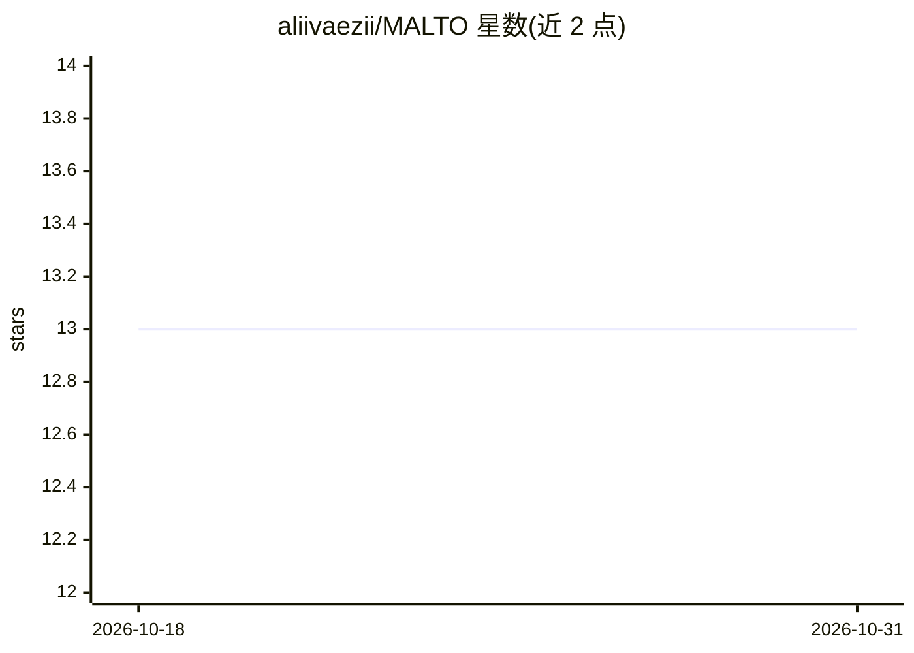

# aliivaezii/MALTO

⭐ 13 · Jupyter Notebook · MIT · 推送 2026-03-19 · [GitHub](https://github.com/aliivaezii/MALTO) · [官网](https://www.kaggle.com/competitions/malto-recruitment-hackathon) · 个人维护

**AI 生成文本 6 分类检测方案：识别文本出自哪个大模型**

MALTO 黑客松（Politecnico di Torino）第 2 名解决方案：判断文本为人类撰写或识别其出自 ChatGPT/Gemini/Grok/DeepSeek/Claude 六类。流水线将 ModernBERT-base（LDAM 损失、渐进 DRW、5 折 CV）与 TF-IDF + Calibrated LinearSVC 通过逐类 Nelder-Mead 集成，辅以温度缩放与阈值调整，Public LB Macro F1 0.95919。主要挑战为 19:1 类别不平衡，DeepSeek/Grok 为最难少数类。提供 Kaggle notebook（T4×2 约 155 分钟）与本地 transformers 加载方式。

## 筛选速览

| 维度 | 判定 | 备注 |
|---|---|---|
| AI 角色 | `ai-native` | 本体是模型或模型工具 |
| 许可风险 | `permissive` | MIT |
| 部署形态 | `None` |  |
| 模型依赖 | — | README 未给出锁定关系 |
| 硬件要求 | — | 无带数字的原话,不猜 |
| 安装摩擦 | `low` | 无编译、无系统依赖或容器化 |
| 成熟度 | — | 结构信号不足 |

## 能力要点

- ModernBERT + TF-IDF/SVC 逐类 Nelder-Mead 集成，Macro F1 0.95919
- LDAM 损失 + 渐进 DRW + 标签平滑应对 19:1 类别不平衡
- 温度缩放与逐类保守阈值后处理
- 包含期望分布 sanity check 与 transformer–SVC 分歧分析

## 适用场景

- 复现 Kaggle 竞赛第 2 名的 AI 文本溯源流水线
- 参考类别不平衡文本分类的集成与校准方法
- 用 transformers 本地加载训练好的检测模型

## 场景标签

 · 领域:NLP/AI 文本检测

## 证据(README 行号)

> L21: Classify text as human-written or identify which AI model generated it across 6 classes:
> L41: ModernBERT-base (5-fold CV) ─┬─ Temperature Scaling ─┬─ Nelder-Mead ─── Threshold ─── Submission

## 星数曲线

2026-10-18 13 → 2026-10-31 13（+0）

---
*卡片 v1 · prompt 1.4 · 生成 2026-10-31 · 置信度 high · 依据 README sha `1b50313f7082` · [字段定义](../../DATASET.md)*
