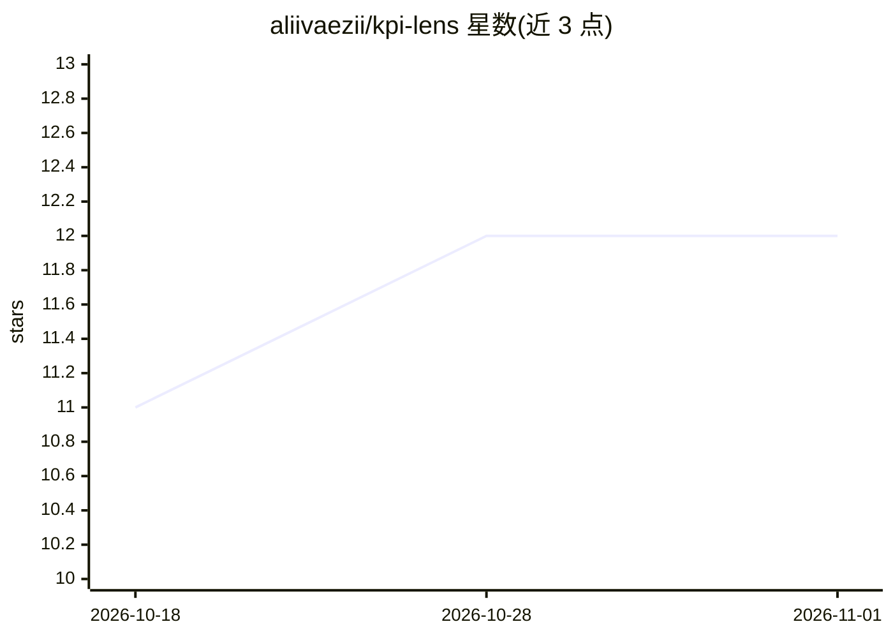

# aliivaezii/kpi-lens

⭐ 12 · Python · 推送 2026-03-24 · [GitHub](https://github.com/aliivaezii/kpi-lens) · 个人维护

**供应链 KPI 监控平台：异常检测 + Claude 根因分析 + 自动报告**

面向供应链团队的运营情报平台：追踪 OTIF、Fill Rate 等 8 个周度 KPI，用 Z-score、IQR、CUSUM、Isolation Forest 四种检测器加权投票发现异常，再由 Claude 生成根因叙述与建议行动，并一键导出 Excel/PowerPoint 报告。提供 Streamlit 看板、FastAPI 后端（10+ 端点）与 MCP 服务器（可接入 Claude Desktop 对话查询）。支持 CSV/Excel 文件监控自动摄取（Pydantic v2 校验），内置 104 周合成数据，需配置 ANTHROPIC_API_KEY，Docker Compose 一键部署。

## 筛选速览

| 维度 | 判定 | 备注 |
|---|---|---|
| AI 角色 | `ai-native` | 本体是模型或模型工具 |
| 许可风险 | `permissive` | — |
| 部署形态 | `self-host` | docker 或自建部署 |
| 模型依赖 | locked-api |  |
| 硬件要求 | — | 无带数字的原话,不猜 |
| 安装摩擦 | `low` | 无编译、无系统依赖或容器化 |
| 成熟度 | — | 结构信号不足 |

## 能力要点

- 4 种统计检测器集成投票的异常检测
- Claude 生成异常根因叙述与建议行动
- Excel 工作簿与 PowerPoint 报告一键导出
- MCP 服务器支持 Claude Desktop 对话查询 KPI 数据

## 适用场景

- 供应链团队自动监控周度 KPI 并接收异常告警
- 让 LLM 分析师解释异常根因并给出建议行动
- 为管理层例会快速生成异常报告演示文稿

## 场景标签

`数据分析` · 领域:效率与自动化

## 证据(README 行号)

> L9: > An AI-powered supply chain intelligence platform that monitors 8 operational KPIs,
> L21: - **Ensemble anomaly detection**: Z-score + IQR + CUSUM + Isolation Forest detectors with weighted voting
> L22: - **LLM root-cause analysis**: Claude generates narrative explanations and recommended actions for each anomaly

## 星数曲线

2026-10-18 11 → 2026-11-01 12（+1）

---
*卡片 v1 · prompt 1.4 · 生成 2026-11-01 · 置信度 mid · 依据 README sha `ede8c1b0b607` · [字段定义](../../DATASET.md)*
