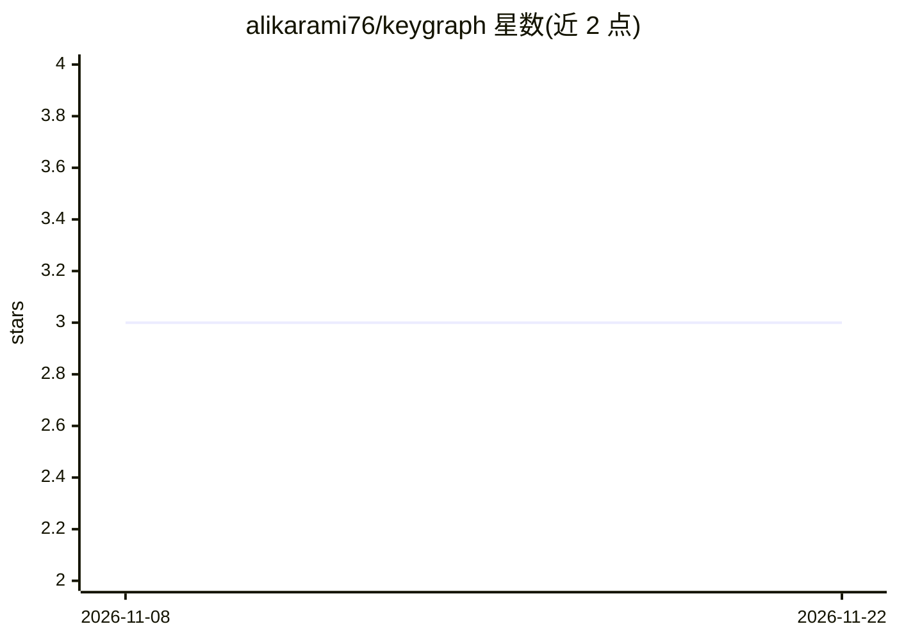

# alikarami76/keygraph

⭐ 3 · Python · MIT · 推送 2026-11-15 · [GitHub](https://github.com/alikarami76/keygraph) · [官网](https://github.com/alikarami76/keygraph#readme) · 个人维护

**为 SQL/数据分析 agent 提供数据库 schema 地图，避免 join 重复计数**

keygraph 读取数据库元数据（键、索引、外键、粒度、状态码、业务上下文）生成 schema 地图，通过 MCP 服务器、CLI --json 或 markdown 文件三种接口提供给 agent 使用。无 LLM 调用、只读元数据、相同输入输出相同结果。支持 MySQL、PostgreSQL、SQLite、SQL Server、ClickHouse、MongoDB 等，也可从 information_schema 转储构建。附离线 HTML 探索器与查询日志功能，MIT 许可，需 Python 3.11+。

## 筛选速览

| 维度 | 判定 | 备注 |
|---|---|---|
| AI 角色 | `ai-ecosystem` | LLM/agent 周边工具 |
| 许可风险 | `permissive` | MIT |
| 部署形态 | `library` | 以包/库形式分发 |
| 模型依赖 | — | README 未给出锁定关系 |
| 硬件要求 | — | 无带数字的原话,不猜 |
| 安装摩擦 | `low` | 无编译、无系统依赖或容器化 |
| 成熟度 | — | 结构信号不足 |

## 能力要点

- 20 个 MCP 工具向 agent 提供 join 路径、fan-out 警告、粒度与状态码
- 确定性输出：不调用 LLM，只读元数据，同输入同输出
- 支持从活跃数据库或 information_schema 转储构建地图
- BIRD 基准上以 ≥0.6 置信度推断 65.4% 声明外键，精度 ≥93.2%

## 适用场景

- 为 text-to-SQL / 数据分析 agent 提供表连接与业务语义上下文
- 排查 agent 因 join fan-out 或状态码误读导致的错误统计结果
- 无数据库连接时从 information_schema 转储离线构建 schema 地图
- 为团队提供可浏览的离线数据库结构文档（HTML 探索器）

## 场景标签

`数据分析` · 领域:效率与自动化

## 证据(README 行号)

> L15: keygraph is an open-source schema map for people building a data analyst agent, a text-to-SQL agent or any other LL
> L17: **At a glance.** MIT licence. Python 3.11 or newer. Reads MySQL, MariaDB, PostgreSQL, SQLite, SQL Server, ClickHous

## 星数曲线

2026-11-08 3 → 2026-11-22 3（+0）

---
*卡片 v1 · prompt 1.4 · 生成 2026-11-22 · 置信度 high · 依据 README sha `1a06d1f1b088` · [字段定义](../../DATASET.md)*
