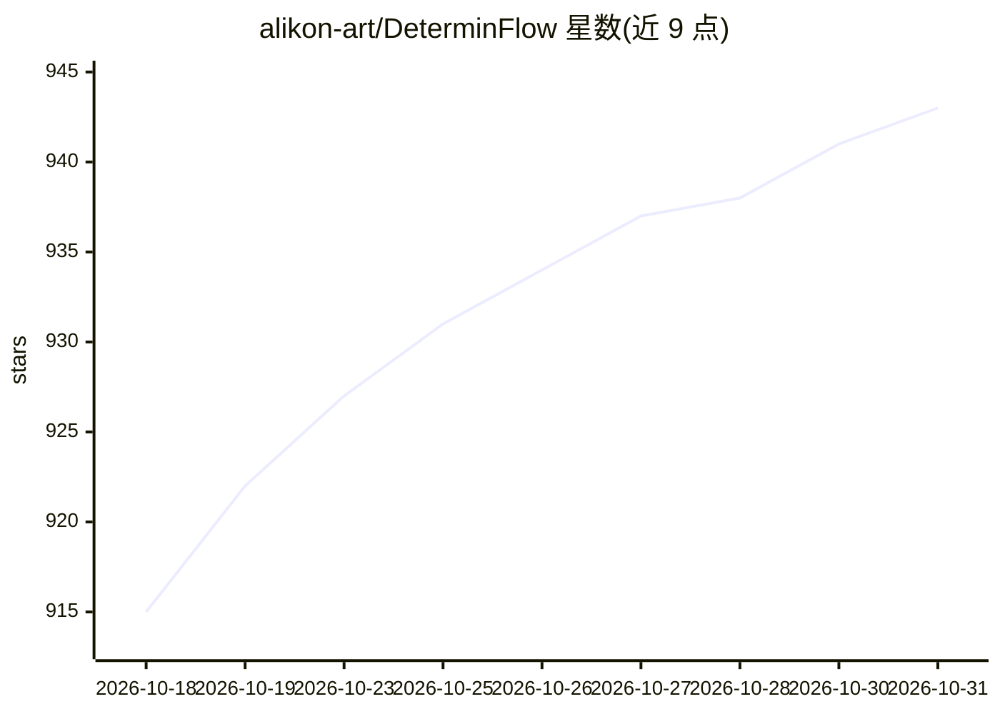

# alikon-art/DeterminFlow

⭐ 943 · Python · AGPL-3.0 · 推送 2026-09-11 · [GitHub](https://github.com/alikon-art/DeterminFlow) · 个人维护 · 中文 README

**面向生产的 AI 工作流运行时：编排、校验、恢复并交付为服务**

DeterminFlow 是一个 AI 工作流运行框架，把 LLM、脚本、API、数据库操作和人工审批组织成有版本、可校验、可重试、可恢复、可审计的工作流。每个 Agent Node 只持有局部上下文与被授权的工具，Runtime 负责控制流、数据流、失败恢复与节点级 Token 记账；提供 FastAPI、React 控制台、Cron、WebSocket 与健康检查，Plugin 机制可打包交付完整业务。提供 Windows/macOS 桌面安装包，也可从源码（Python 3.11+ / Node.js 22.12+）或 Docker 运行；许可证 AGPL-3.0。已在笔枢写作的 AI 小说生产链路中完成生产验证。

## 筛选速览

| 维度 | 判定 | 备注 |
|---|---|---|
| AI 角色 | `ai-ecosystem` | LLM/agent 周边工具 |
| 许可风险 | `viral` | AGPL-3.0 |
| 部署形态 | `desktop` | 安装包/桌面程序 |
| 模型依赖 | locked-api |  |
| 硬件要求 | — | 无带数字的原话,不猜 |
| 安装摩擦 | `low` | 无编译、无系统依赖或容器化 |
| 成熟度 | — | 结构信号不足 |

## 能力要点

- Agent/Script/Approval/Subprocess 四类 Core Node，支持变量、条件、并行、循环与子流程编排
- 失败节点恢复、执行检查点与跨进程重启续跑
- 节点级会话、Token 账本、工具白名单与 JSON 输出修复重试
- Plugin 体系与资源广场，可打包 Workflow、Skill、API 交付完整业务

## 适用场景

- 把已明确的 AI 多步骤流程搭成可恢复、可审计的生产服务
- 通过节点级上下文隔离控制长流程的 Token 消耗
- 将成熟 Workflow 以 Plugin 形式交给团队或社区安装使用

## 场景标签

`工作流自动化` · 领域:效率与自动化

## 证据(README 行号)

> L27: DeterminFlow 是一个面向生产的 AI 工作流运行框架。它把 LLM、脚本、API、数据库操作
> L106: - FastAPI、React 控制台、Cron Automation、WebSocket 事件和健康检查
> L131: 1. Task 启动时冻结 Workflow、参数和节点输入。

## 星数曲线

2026-10-18 915 → 2026-10-31 943（+28）

---
*卡片 v1 · prompt 1.4 · 生成 2026-10-21 · 置信度 mid · 依据 README sha `a339b4513318` · [字段定义](../../DATASET.md)*
