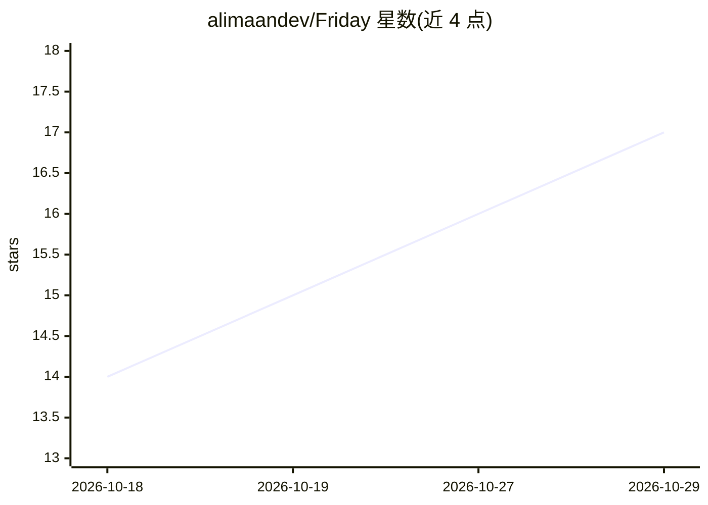

# alimaandev/Friday

⭐ 17 · Python · MIT · 推送 2026-10-22 · [GitHub](https://github.com/alimaandev/Friday) · [官网](https://github.com/alimaandev/Friday) · 个人维护

**开源桌面 JARVIS 级 AI 助手：语音/手势交互、控机与自动化**

运行在用户本地硬件上的桌面 AI 助手：支持语音、手势与文字输入，可控制电脑（开应用、点击、输入，动作需确认）、执行 cron 自动化、屏幕与摄像头视觉分析，并配 3D 反应球体与三人格语音输出。内置插件市场、自然语言自定义工具、本地 RAG 与从对话抽取实体的知识图谱，三套并行记忆引擎（TF-IDF/Jaccard/向量）支持跨会话召回。LLM 提供方可插拔（OpenRouter/OpenAI/Ollama/Anthropic/自定义），Blackout 模式可强制全本地。React 19 + Python Quart 后端，通过 SSE 与 REST 通信；安装方式为 git clone 源码、npm run friday 或 Docker Compose。

## 筛选速览

| 维度 | 判定 | 备注 |
|---|---|---|
| AI 角色 | `ai-native` | 本体是模型或模型工具 |
| 许可风险 | `permissive` | MIT |
| 部署形态 | `self-host` | docker 或自建部署 |
| 模型依赖 | local-ok | 支持本地模型 |
| 硬件要求 | — | 无带数字的原话,不猜 |
| 安装摩擦 | `low` | 无编译、无系统依赖或容器化 |
| 成熟度 | — | 结构信号不足 |

## 能力要点

- 语音/手势/文字多模态输入，三人格语音输出
- 电脑控制（pyautogui/pywin32）+ cron 自动化引擎
- 本地 RAG、知识图谱与三套并行记忆引擎
- Blackout 模式：断网工具、强制本地 Ollama、零出站 AI 流量

## 适用场景

- 用一个本地桌面助手完成日程、邮件、屏幕分析等日常任务
- 自定义插件和自然语言工具扩展助手能力
- 在完全离线（Ollama + Blackout）模式下使用 AI 助手

## 场景标签

`AI 助手` `GUI 自动化` `RAG` `知识图谱` · 领域:效率与自动化

## 证据(README 行号)

> L45: **Friday** is an open-source JARVIS-class AI that lives on your desktop. Speak to it, gesture at it, or type — it s
> L103: - 🔑 **Bring your own LLM** — plug in OpenRouter, OpenAI, Ollama, or any OpenAI-compatible endpoint. Your key, your

## 星数曲线

2026-10-18 14 → 2026-10-29 17（+3）

---
*卡片 v1 · prompt 1.4 · 生成 2026-10-29 · 置信度 mid · 依据 README sha `b80e503e29dd` · [字段定义](../../DATASET.md)*
