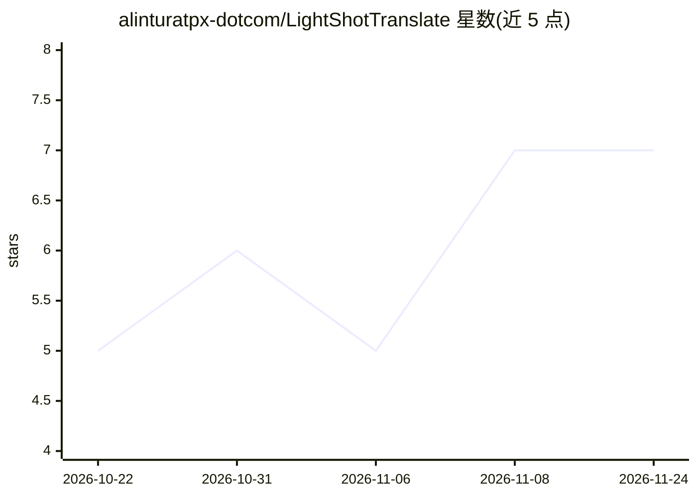

# alinturatpx-dotcom/LightShotTranslate

⭐ 7 · C++ · 推送 2026-10-19 · [GitHub](https://github.com/alinturatpx-dotcom/LightShotTranslate) · 个人维护 · 中文 README

**Windows 截图工具：本地 OCR 识字、原位覆盖翻译、贴图与 AI 悬浮球**

面向 Windows 用户的轻量截图工具，链路为热键→截图→框选→标注/OCR/翻译/贴图。OCR 以独立原生子进程运行（ONNX Runtime + PP-OCRv4 移动端模型），空闲自动退出回收内存，识别完全离线；翻译走用户自配的 OpenAI 兼容接口，按段落原位覆盖并带批量校验、失败重试与结果缓存；另有问答/翻译双会话的 AI 悬浮球。以 .NET 8 WinForms 实现，提供 Inno Setup 安装包与自包含便携包。

## 筛选速览

| 维度 | 判定 | 备注 |
|---|---|---|
| AI 角色 | `ai-native` | 本体是模型或模型工具 |
| 许可风险 | `none` | — |
| 部署形态 | `desktop` | 安装包/桌面程序 |
| 模型依赖 | — | README 未给出锁定关系 |
| 硬件要求 | — | 无带数字的原话,不猜 |
| 安装摩擦 | `medium` | 含编译或系统依赖之一 |
| 成熟度 | — | 结构信号不足 |

## 能力要点

- 本地离线 OCR：ONNX Runtime + PP-OCRv4，子进程用完即退
- 原位覆盖翻译：按段落合并/换行/自适应字号贴回原文位置
- API Key 用 Windows DPAPI 加密，译文按行严格校验防错位
- 自动框选窗口/控件、贴图缩放、对话记录导出 TXT/Markdown

## 适用场景

- 截图后对屏幕上的外文直接原位翻译阅读
- 离线识字并复制图片中的文字
- 把截图贴在桌面置顶缩放查看并二次识字翻译
- 划词调用 AI 问答或翻译

## 场景标签

`OCR` · 领域:感知与多模态

## 证据(README 行号)

> L3: Windows 轻量截图工具：**截图 · 画笔标注 · 本地 OCR 识字 · 原位覆盖翻译 · 贴图**。
> L4: C# / .NET 8 / WinForms，托盘常驻；OCR 跑在独立的原生子进程里（ONNX Runtime + PP-OCRv4 移动端模型），用完即退，空闲时几乎不占内存。
> L14: - **AI 悬浮球**：问答 / 翻译双会话（历史互不干扰）、流式输出、划词工具栏、对话记录查看与导出（TXT / Markdown）。

## 星数曲线

2026-10-22 5 → 2026-11-24 7（+2）

---
*卡片 v1 · prompt 1.4 · 生成 2026-11-20 · 置信度 high · 依据 README sha `6d2bfd8093a0` · [字段定义](../../DATASET.md)*
