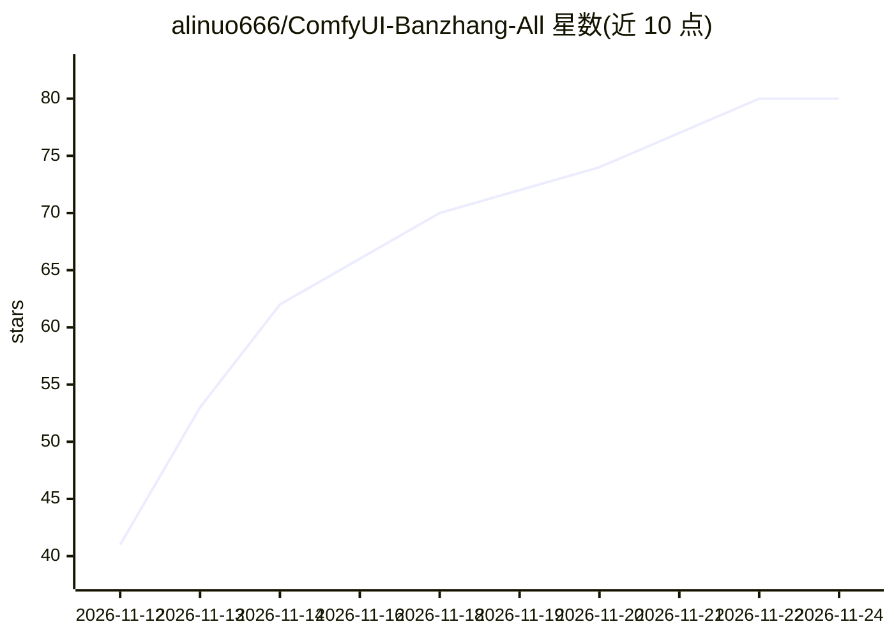

# alinuo666/ComfyUI-Banzhang-All

⭐ 80 · Python · GPL-3.0 · 推送 2026-11-21 · [GitHub](https://github.com/alinuo666/ComfyUI-Banzhang-All) · [官网](https://space.bilibili.com/15838129) · 个人维护 · 中文 README

**面向 MiniMax H3 的 ComfyUI 中文节点包：三采工作流生成高清视频**

一个 ComfyUI 自定义节点包，围绕 MiniMax H3 视频模型组织『三采』工作流，README 声称 6GB 显存可运行高清视频生成。内置约 100 个节点，覆盖多段续写、H3 导演台、文案台与媒体架、MV 按节拍排片、钉帧漂移控制与显存管理。安装方式为将仓库放入 custom_nodes 目录并重启 ComfyUI，Python 依赖见 requirements.txt；模型权重与 NVIDIA VFX/DLSS/Topaz 专有引擎不随包分发，需按各自许可自行获取，缺失时相关节点不生效。ffmpeg 由插件自动查找或下载。代码采用 GPL-3.0-or-later，生成内容不受 GPL 约束。

## 筛选速览

| 维度 | 判定 | 备注 |
|---|---|---|
| AI 角色 | `ai-ecosystem` | LLM/agent 周边工具 |
| 许可风险 | `dual` | GPL-3.0 |
| 部署形态 | `None` |  |
| 模型依赖 | — | README 未给出锁定关系 |
| 硬件要求 | `gpu-8g` | |
| 安装摩擦 | `medium` | 含编译或系统依赖之一 |
| 成熟度 | — | 结构信号不足 |

## 能力要点

- 三采工作流，README 称 6GB 显存可跑高清视频
- 约 100 个节点：导演台、文案台、媒体架、多段续写、MV 节拍排片
- ffmpeg 查找统一（系统 PATH/自带/自动下载），无需手动安装
- 模型权重经夸克网盘镜像汇总下载

## 适用场景

- 在低显存（6GB）环境下用 ComfyUI 生成高清视频
- 制作多段续写的短剧、MV、广告视频
- 用中文界面管理分段文案与参考素材进行视频生产

## 场景标签

`视频生成` · 领域:内容生成

## 证据(README 行号)

> L5: A Chinese-language ComfyUI custom node pack for video generation with the MiniMax H3 model. Built around the "three-
> L20: 1. Put this repository into `ComfyUI/custom_nodes/ComfyUI-Banzhang-All`.
> L110: 一个面向 MiniMax H3 视频模型视频生成的 ComfyUI 中文插件。主打三采工作流，6GB 显存也能跑高清视频。

## 星数曲线

2026-11-12 41 → 2026-11-24 80（+39）

---
*卡片 v1 · prompt 1.4 · 生成 2026-11-18 · 置信度 high · 依据 README sha `fef85b4ced08` · [字段定义](../../DATASET.md)*
