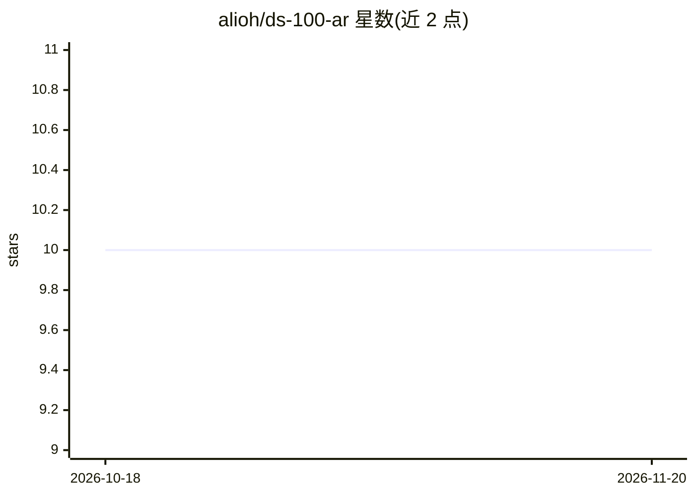

# alioh/ds-100-ar

⭐ 10 · HTML · 推送 2026-11-11 · [GitHub](https://github.com/alioh/ds-100-ar) · [官网](https://alioh.github.io/ds-100-ar) · 个人维护

**加州大学伯克利 Data 100 教科书阿拉伯语译本**

伯克利 Data 100（数据科学原理与技术）课程的阿拉伯语翻译版教材，由译者获得原作者 Sam Lau 授权后翻译。采用意译方式，关键术语附英文原文，数学公式与代码保留英文；对原文未展开的标题补充译者注释与参考链接。推荐配合 Jupyter Notebook 阅读运行书中代码。全文按 CC BY-NC-ND 4.0 许可发布，供免费使用。

## 筛选速览

| 维度 | 判定 | 备注 |
|---|---|---|
| AI 角色 | `ai-knowledge` | 知识聚合/清单类 |
| 许可风险 | `none` | — |
| 部署形态 | `None` |  |
| 模型依赖 | — | README 未给出锁定关系 |
| 硬件要求 | — | 无带数字的原话,不猜 |
| 安装摩擦 | `low` | 无编译、无系统依赖或容器化 |
| 成熟度 | — | 结构信号不足 |

## 能力要点

- 获得原作者 Sam Lau 授权的官方课程教材译本
- 术语对照策略：关键术语附英文，公式与代码保留英文
- 译者补充注释与扩展阅读链接（📝 标记）
- CC BY-NC-ND 4.0 许可，免费使用

## 适用场景

- 阿拉伯语学习者系统学习数据科学课程内容
- 配合 Jupyter Notebook 运行书中代码示例
- 作为 Data 8 之后进阶课程的学习材料

## 场景标签

`教程课程` · 领域:学习与行业

## 证据(README 行号)

> L1: هذا الكتاب يخص مادة [داتا 100، مبادئ وتقنيات علم البيانات في جامعة كاليفورنيا - بيركلي][ds100].
> L18: داتا 100 هي مادة متقدمة، وتستمر على طول السنة التعليمية وتأتي بعد [داتا 8، مبادئ علم البيانات][data8].
> L22: Creative Commons Attribution-NonCommercial-NoDerivatives 4.0 International (CC BY-NC-ND 4.0)

## 星数曲线

2026-10-18 10 → 2026-11-20 10（+0）

---
*卡片 v1 · prompt 1.4 · 生成 2026-11-20 · 置信度 high · 依据 README sha `236b0eedd9e5` · [字段定义](../../DATASET.md)*
