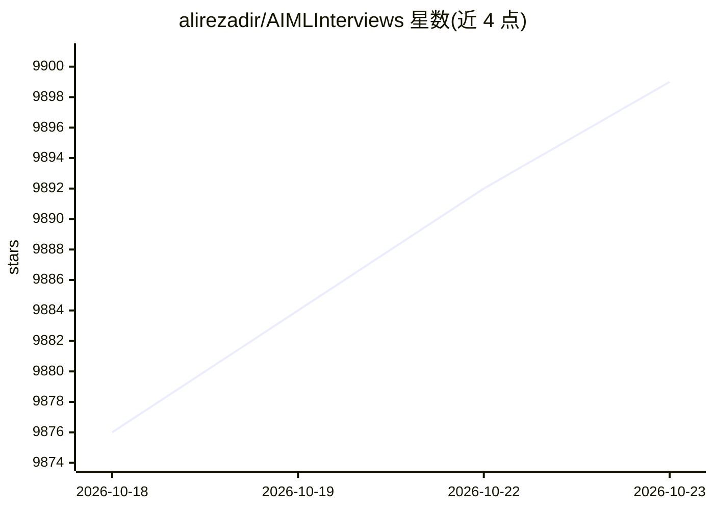

# alirezadir/AIMLInterviews

⭐ 9,899 · Jupyter Notebook · MIT · 推送 2026-10-08 · [GitHub](https://github.com/alirezadir/AIMLInterviews) · [官网](https://www.aimlinterviews.io/) · 个人维护

**AI/ML 技术面试准备指南：题解、系统设计与 MCP 辅导服务器**

面向大厂（尤其 FAANG）AI/ML 工程师、Applied Scientist、Tech Lead 等岗位求职者的面试准备知识库：按 DSA 编码、ML 编码、ML 广度（经典 ML、GenAI、Agentic AI）、系统设计、行为与领导力面试组织内容，并附 GenAI 学习资源与 Agentic AI 系统资料。内容基于作者本人 2020 年获 5 个 offer、2025 年再获 Amazon/Apple offer 的准备笔记。另提供 aimlinterviews-mcp 服务器，可将 MCP 兼容的 AI 助手变为面试教练（渐进提示、学习计划、答案点评）；作者还提供 1:1 付费辅导服务。

## 筛选速览

| 维度 | 判定 | 备注 |
|---|---|---|
| AI 角色 | `ai-knowledge` | 知识聚合/清单类 |
| 许可风险 | `permissive` | MIT |
| 部署形态 | `library` | 以包/库形式分发 |
| 模型依赖 | — | README 未给出锁定关系 |
| 硬件要求 | — | 无带数字的原话,不猜 |
| 安装摩擦 | `low` | 无编译、无系统依赖或容器化 |
| 成熟度 | — | 结构信号不足 |

## 能力要点

- 按 5 个面试模块组织的知识库（DSA/ML 编码/广度/系统设计/行为面）
- aimlinterviews-mcp：把 MCP 兼容 AI 助手变为面试教练，npx 一条命令安装
- 覆盖 GenAI、Agentic AI、多模态等 2026 更新内容
- 附 GenAI 学习资源与 Agentic AI 系统资料

## 适用场景

- 准备 FAANG 等大厂 AI/ML 技术面试的系统化复习
- 把 Claude/Codex 等助手配置成 AI 面试教练做渐进式练习
- 了解 AI/ML 面试各模块的常见考察结构

## 场景标签

`教程课程` · 领域:学习与行业

## 证据(README 行号)

> L19: This repo aims to serve as a guide to prepare for **AI and ML Technical interviews** for relevant roles at big tech
> L23: The following components are the most commonly used interview modules for technical ML roles at different companies

## 星数曲线

2026-10-18 9,876 → 2026-10-23 9,899（+23）

---
*卡片 v1 · prompt 1.4 · 生成 2026-10-20 · 置信度 high · 依据 README sha `356a04d12194` · [字段定义](../../DATASET.md)*
