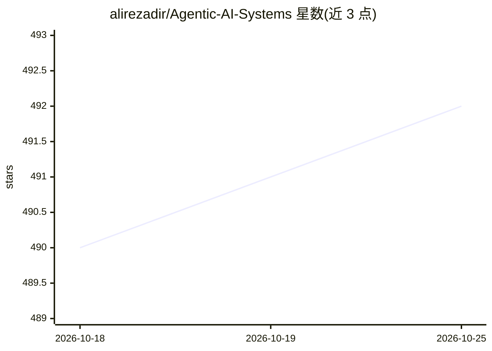

# alirezadir/Agentic-AI-Systems

⭐ 493 · Python · MIT · 推送 2026-06-20 · [GitHub](https://github.com/alirezadir/Agentic-AI-Systems) · 个人维护

**面向开发者的 Agentic AI 系统设计知识库与实战指南**

个人维护的策展型知识库，汇集构建生产级 AI agent 与多智能体系统的资源与示例：覆盖 agentic 设计模式、RAG 架构、系统架构、评测方法、OpenAI Agents SDK 指南，以及用 LangGraph、LangChain、CrewAI、LlamaIndex 构建工作流和多智能体系统的代码示例，另附课程、工具与协议的资源清单。定位为参考手册式学习资料，持续更新。

## 筛选速览

| 维度 | 判定 | 备注 |
|---|---|---|
| AI 角色 | `ai-knowledge` | 知识聚合/清单类 |
| 许可风险 | `permissive` | MIT |
| 部署形态 | `None` |  |
| 模型依赖 | — | README 未给出锁定关系 |
| 硬件要求 | — | 无带数字的原话,不猜 |
| 安装摩擦 | `low` | 无编译、无系统依赖或容器化 |
| 成熟度 | — | 结构信号不足 |

## 能力要点

- 设计模式、RAG 架构、系统架构、AgentOps 等主题的策展综述
- 基于 OpenAI Agents、LangGraph、CrewAI、LlamaIndex 的代码示例与教程
- 多智能体系统构建示例与评测方法整理
- 附课程、工具、协议的资源清单

## 适用场景

- 学习 agentic AI 系统设计与设计模式
- 查找用主流框架构建 agent 工作流的代码示例
- 了解多智能体系统与 RAG 架构的常见方案

## 场景标签

`精选清单` `教程课程` · 领域:学习与行业

## 证据(README 行号)

> L5: Welcome to **Agentic-AI-Systems** a curated and evolving knowledge base and hands-on guide for learning about Agents
> L21: - **Code Examples:** Step-by-step guides, example codes, and tutorials for building agentic workflows with Open AI 

## 星数曲线

2026-10-18 490 → 2026-10-25 492（+2）

---
*卡片 v1 · prompt 1.4 · 生成 2026-10-21 · 置信度 high · 依据 README sha `276c97015a44` · [字段定义](../../DATASET.md)*
