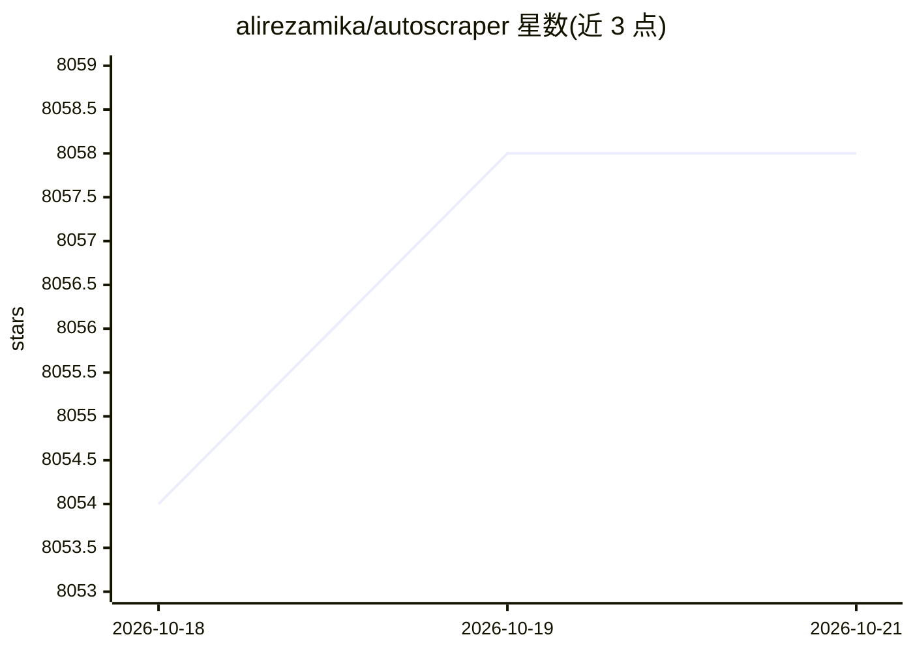

# alirezamika/autoscraper

⭐ 8,058 · Python · MIT · 推送 2026-07-29 · [GitHub](https://github.com/alirezamika/autoscraper) · 个人维护

**给开发者的智能网页爬虫：从样例数据自动学习抓取规则**

Python 网页抓取库：输入 URL 或 HTML 及希望抓取的样例数据列表（文本、URL 或任意 HTML 标签值），学习出抓取规则并返回页面中的相似元素；学到的模型可保存加载，并对新 URL 获取相似或精确顺序的结果。支持传入 requests 参数（如代理、自定义 header）。兼容 Python 3，可经 PyPI、git 仓库 pip 或源码安装。README 未说明内部学习算法细节，未提及浏览器渲染方案。

## 筛选速览

| 维度 | 判定 | 备注 |
|---|---|---|
| AI 角色 | `ai-native` | 本体是模型或模型工具 |
| 许可风险 | `permissive` | MIT |
| 部署形态 | `library` | 以包/库形式分发 |
| 模型依赖 | — | README 未给出锁定关系 |
| 硬件要求 | — | 无带数字的原话,不猜 |
| 安装摩擦 | `low` | 无编译、无系统依赖或容器化 |
| 成熟度 | — | 结构信号不足 |

## 能力要点

- 从样例数据学习抓取规则，返回相似元素
- 学习到的模型可 save/load 复用于新 URL
- get_result_exact 按样例列表顺序返回精确结果
- 支持代理与自定义 header 的 requests 参数

## 适用场景

- 抓取 StackOverflow 相关帖子标题等列表型数据
- 抓取股票价格、市值等动态数值信息
- 把任意网站内容包装成 API 供程序调用

## 场景标签

`网页抓取` · 领域:效率与自动化

## 证据(README 行号)

> L5: This project is made for automatic web scraping to make scraping easy.
> L6: It gets a url or the html content of a web page and a list of sample data which we want to scrape from that page. **

## 星数曲线

2026-10-18 8,054 → 2026-10-21 8,058（+4）

---
*卡片 v1 · prompt 1.4 · 生成 2026-10-20 · 置信度 mid · 依据 README sha `b5af8b87781b` · [字段定义](../../DATASET.md)*
