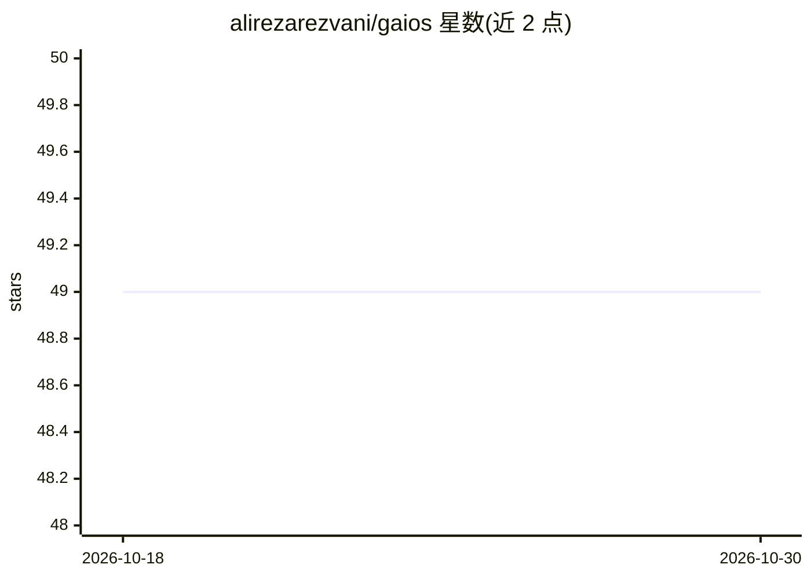

# alirezarezvani/gaios

⭐ 49 · Python · NOASSERTION · 推送 2026-06-06 · [GitHub](https://github.com/alirezarezvani/gaios) · 个人维护

**给个人用户的 AI 工作流操作系统蓝图：技能、维基与确定性工具**

面向在 Claude Code 或 Codex 等代理式编码工具中工作的个人用户的开源蓝图仓库：克隆后运行 /setup 引导式访谈填充 CLAUDE.md 与上下文目录，即获得二脑维基、知识图谱（graphify）、动态自验证工作流、Chief-of-Staff 起草/简报/决策等斜杠技能，以及 tools/ 下的确定性 Python 工具。非独立运行的软件，依赖外部代理运行时加载其指令与技能文件；Claude Code 为一等支持，Codex 经 AGENTS.md 支持，其他代理经指令文件兼容。MIT 许可，灵感注明 Nate Herk。

## 筛选速览

| 维度 | 判定 | 备注 |
|---|---|---|
| AI 角色 | `ai-ecosystem` | LLM/agent 周边工具 |
| 许可风险 | `none` | NOASSERTION |
| 部署形态 | `None` |  |
| 模型依赖 | — | README 未给出锁定关系 |
| 硬件要求 | — | 无带数字的原话,不猜 |
| 安装摩擦 | `low` | 无编译、无系统依赖或容器化 |
| 成熟度 | — | 结构信号不足 |

## 能力要点

- /setup 引导访谈生成个性化 CLAUDE.md 与 context/ 上下文
- 二脑维基 /wiki 与 graphify 知识图谱（/graph、/graph-query、/graph-ingest）
- 自验证动态工作流 /workflow 与 autoresearch 循环 /experiment
- 跨运行时兼容：Claude Code 一等，Codex 支持，其他代理经 AGENTS.md

## 适用场景

- 把 Claude Code / Codex 变成个人工作助手，代管收件箱、日程简报与决策记录
- 用 /wiki 和知识图谱沉淀个人/团队笔记与代码知识
- 克隆并定制为特定角色或领域的个人操作系统

## 场景标签

`AI 助手` `工作流自动化` `知识库管理` `知识图谱` · 领域:效率与自动化

## 证据(README 行号)

> L3: Clone it, run `/setup`, and it becomes **yours** in **Claude Code or Codex** — a second brain + Chief of Staff that 
> L63: gAIOS runs on any agentic coding tool that reads a project-instructions file. **Claude Code is first-class; Codex /
> L31: - `/workflow` — **dynamic workflows**: goal-driven, composable, self-verifying pipelines with a quality gate per st

## 星数曲线

2026-10-18 49 → 2026-10-30 49（+0）

---
*卡片 v1 · prompt 1.4 · 生成 2026-10-24 · 置信度 high · 依据 README sha `8c69ba4d0d2c` · [字段定义](../../DATASET.md)*
