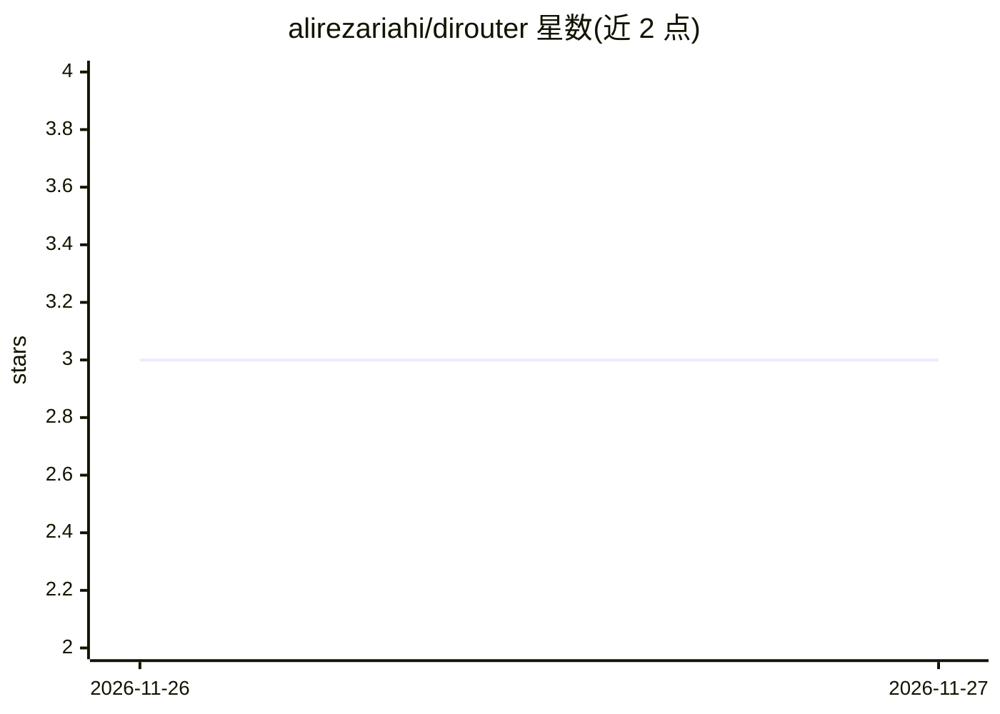

# alirezariahi/dirouter

⭐ 3 · TypeScript · Apache-2.0 · 推送 2026-11-26 · [GitHub](https://github.com/alirezariahi/dirouter) · 个人维护 · 中文 README

**自托管 LLM 网关：多提供商路由、回退、限流与用量计费**

自托管的大型语言模型网关，暴露 OpenAI 与 Anthropic 兼容端点，请求经八阶段流水线处理：虚拟密钥校验、限流（Valkey 原子 Lua 脚本，失效时本地降级）、路由、格式翻译、带退避重试与回退的分发、用量记账。提供按密钥/团队/项目的预算控制、供应商与凭证级熔断器、版本化配置快照热推送。组件含 Traefik、gateway、control-api、worker、dashboard 与 portal（波斯语 RTL 界面），运行依赖 PostgreSQL 17 与 Valkey，通过 Docker Compose 部署，面向需要运营级流量管理的开发团队。

## 筛选速览

| 维度 | 判定 | 备注 |
|---|---|---|
| AI 角色 | `ai-ecosystem` | LLM/agent 周边工具 |
| 许可风险 | `permissive` | Apache-2.0 |
| 部署形态 | `self-host` | docker 或自建部署 |
| 模型依赖 | — | README 未给出锁定关系 |
| 硬件要求 | — | 无带数字的原话,不猜 |
| 安装摩擦 | `low` | 无编译、无系统依赖或容器化 |
| 成熟度 | — | 结构信号不足 |

## 能力要点

- OpenAI 与 Anthropic 格式双向翻译的兼容端点
- 供应商/模型熔断器、凭证冷却与流式安全回退
- 分布式 RPM/TPM 限流与按密钥/团队/项目预算（BigInt 整数记账）
- 版本化配置快照推送，控制面不可用时数据面继续服务

## 适用场景

- 为多提供商 LLM 调用统一入口并自动故障回退
- 按密钥和项目控制 API 支出预算
- 单家供应商宕机或配额耗尽时保持服务可用
- 集中管理凭证、限流与用量账单

## 场景标签

`模型网关` · 领域:Agent 开发

## 证据(README 行号)

> L12: DiRouter is a self-hosted gateway for Large Language Models. It exposes OpenAI- and Anthropic-compatible endpoints 
> L3:  DiRouter · open-source LLM gateway for resilient routing, fallback, limits, budgets, and usage accounting
> L55: |Needs to self-host|PostgreSQL, Valkey|PostgreSQL for keys; Redis with several instances|Nothing (stateless); Redis

## 星数曲线

2026-11-26 3 → 2026-11-27 3（+0）

---
*卡片 v1 · prompt 1.4 · 生成 2026-11-26 · 置信度 mid · 依据 README sha `7eb5d073331f` · [字段定义](../../DATASET.md)*
