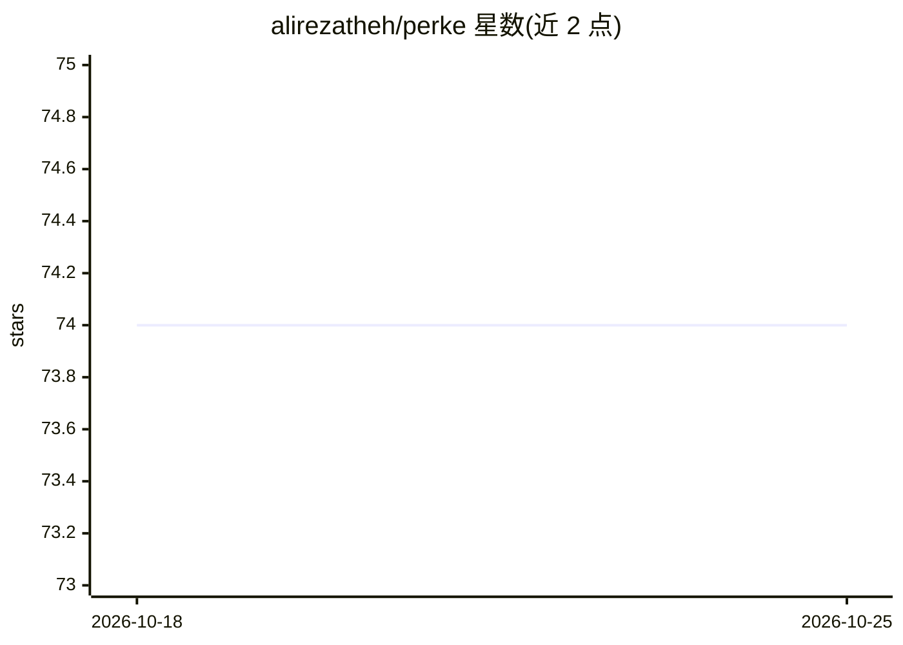

# alirezatheh/perke

⭐ 74 · Python · MIT · 推送 2026-10-19 · [GitHub](https://github.com/alirezatheh/perke) · 个人维护

**波斯语文本关键短语抽取的 Python 库**

Perke 是面向波斯语的 Python 关键短语抽取包，提供端到端抽取流水线，各组件可修改或扩展以开发新模型。实现了 TextRank、SingleRank、TopicRank、PositionRank、MultipartiteRank 五种无监督图模型。依赖 Hazm 的 POS 标注模型（可通过 python -m perke download 下载，或自行放置兼容模型到 resources 目录）。以 pip 从 PyPI 安装，受 pke 启发。

## 筛选速览

| 维度 | 判定 | 备注 |
|---|---|---|
| AI 角色 | `ai-native` | 本体是模型或模型工具 |
| 许可风险 | `permissive` | MIT |
| 部署形态 | `library` | 以包/库形式分发 |
| 模型依赖 | — | README 未给出锁定关系 |
| 硬件要求 | — | 无带数字的原话,不猜 |
| 安装摩擦 | `low` | 无编译、无系统依赖或容器化 |
| 成熟度 | — | 结构信号不足 |

## 能力要点

- 端到端波斯语关键短语抽取流水线，组件可替换扩展
- 实现 5 种无监督图模型（TextRank/SingleRank/TopicRank/PositionRank/MultipartiteRank）
- 标准化 API，4 行代码即可运行 TextRank
- 内置命令下载 Hazm POS 标注模型

## 适用场景

- 从波斯语文档或文章中自动抽取关键词/关键短语
- 在无监督图模型基础上开发新的关键短语抽取方法
- 波斯语 NLP 流水线中的关键词提取环节

## 场景标签

 · 领域:自然语言处理/信息检索

## 证据(README 行号)

> L8: Perke is a Python keyphrase extraction package for Persian language. It
> L9: provides an end-to-end keyphrase extraction pipeline in which each component
> L34: Perke provides a standardized API for extracting keyphrases from a text. Start

## 星数曲线

2026-10-18 74 → 2026-10-25 74（+0）

---
*卡片 v1 · prompt 1.4 · 生成 2026-10-24 · 置信度 high · 依据 README sha `87b9b6518744` · [字段定义](../../DATASET.md)*
