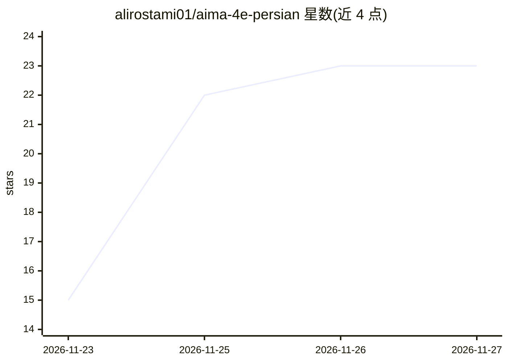

# alirostami01/aima-4e-persian

⭐ 23 · HTML · GPL-3.0 · 推送 2026-11-23 · [GitHub](https://github.com/alirostami01/aima-4e-persian) · [官网](https://alirostami.com/aima-4e-persian) · 个人维护

**AIMA 第4版教科书的波斯语翻译开源项目**

对 Russell 与 Norvig《人工智能：一种现代方法》第4版的非官方波斯语翻译与排版项目：提供序言及全部 28 章的结构化译本，输出 Markdown、HTML、PDF 三种格式（PDF 共 1,176 页，含整书与分章版本），收录 407 张书籍插图，技术伪代码保留英文以便与原文对照。PDF 构建基于 Playwright 驱动的 Chromium 与 PyMuPDF，字体随仓库内置。项目以 GPL v3.0 发布，声明与原作者及出版方无官方关联，面向波斯语学生、程序员、研究人员与 AI 爱好者。

## 筛选速览

| 维度 | 判定 | 备注 |
|---|---|---|
| AI 角色 | `ai-knowledge` | 知识聚合/清单类 |
| 许可风险 | `viral` | GPL-3.0 |
| 部署形态 | `library` | 以包/库形式分发 |
| 模型依赖 | — | README 未给出锁定关系 |
| 硬件要求 | — | 无带数字的原话,不猜 |
| 安装摩擦 | `low` | 无编译、无系统依赖或容器化 |
| 成熟度 | — | 结构信号不足 |

## 能力要点

- 28 章波斯语结构化翻译，提供 Markdown/HTML/PDF 三种格式
- 1,176 页完整 PDF 与 28 个分章 PDF，含双语目录与 PDF 书签树
- 407 张书籍插图按章节存放于 figures/ 目录
- 技术伪代码保留英文，与原版及算法实现可直接对照

## 适用场景

- 以波斯语系统学习 AIMA 教材内容
- 贡献翻译校对或通过 Issue/PR 提交术语修正
- 从 HTML 源文件自行构建 PDF 版本

## 场景标签

`教程课程` · 领域:学习与行业

## 证据(README 行号)

> L23: این مخزن یک پروژهٔ متن‌باز برای **ترجمه، تدوین و ارائهٔ فارسی** کتاب شناخته‌شدهٔ **Artificial Intelligence: A Moder
> L25: هدف پروژه این است که مفاهیم گستردهٔ هوش مصنوعی را به شکلی ساختاریافته، خوانا و قابل استفاده برای فارسی‌زبانان ارائه
> L31: - 🇮🇷 ترجمهٔ فارسی ساختاریافتهٔ پیشگفتار و **۲۸ فصل کتاب**

## 星数曲线

2026-11-23 15 → 2026-11-27 23（+8）

---
*卡片 v1 · prompt 1.4 · 生成 2026-11-23 · 置信度 high · 依据 README sha `55ac99cf5f03` · [字段定义](../../DATASET.md)*
