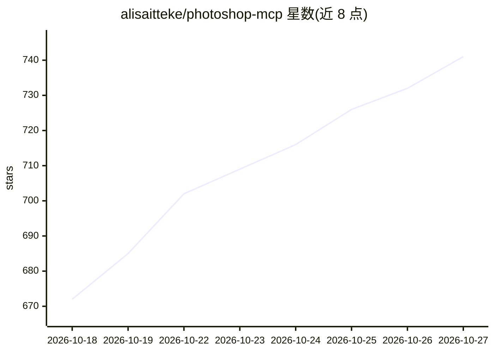

# alisaitteke/photoshop-mcp

⭐ 741 · TypeScript · MIT · 推送 2026-10-24 · [GitHub](https://github.com/alisaitteke/photoshop-mcp) · [官网](https://photoshop-mcp.com) · 个人维护 · 中文 README

**MCP 服务器：让 Cursor/Claude 等 AI 通过自然语言操控 Photoshop**

基于 TypeScript 的 Photoshop MCP 服务器，提供 128 个工具（111 个原子操作 + 17 个一步 recipe），通过 ExtendScript 桥接控制 Photoshop 执行抠图、人像修饰、网页导出、轮播图拆分、批量加水印、调色等操作，多步 recipe 以单次可撤销步骤落地。支持 Cursor 插件、Claude Code 命令及自带浏览器聊天窗口三种使用方式；实验性的 Jev 路由可将 26 类安全命令免 LLM 直达 Photoshop（需 TYPESAFE_API_KEY，opt-in）。需 Photoshop 2012+ 运行与 Node.js 18+，非 Adobe 官方项目。

## 筛选速览

| 维度 | 判定 | 备注 |
|---|---|---|
| AI 角色 | `ai-ecosystem` | LLM/agent 周边工具 |
| 许可风险 | `permissive` | MIT |
| 部署形态 | `library` | 以包/库形式分发 |
| 模型依赖 | — | README 未给出锁定关系 |
| 硬件要求 | — | 无带数字的原话,不猜 |
| 安装摩擦 | `low` | 无编译、无系统依赖或容器化 |
| 成熟度 | `idea` | |

## 能力要点

- 128 个工具（111 原子 + 17 一步 recipe），多步操作合并为单个撤销步骤
- Jev 意图路由：安全命令免 LLM 调用直达 Photoshop（实验性、opt-in）
- 三种使用方式：自带聊天窗口 / Cursor 插件 / Claude Code 或任意 MCP 客户端
- 内置聊天窗口可复用 Claude Code / Gemini CLI 账号，无需另配 key

## 适用场景

- 用自然语言让 AI 助手完成抠图、修图、批量导出等 Photoshop 操作
- 在 Cursor 或 Claude Code 中直接驱动 Photoshop 处理设计文件
- 批量处理图片：加水印、按平台尺寸导出、拆分轮播图

## 场景标签

`图像视频处理` · 领域:感知与多模态

## 证据(README 行号)

> L22: **Chat with Photoshop like a colleague.** Describe what you want in plain words —
> L63: Under the hood: 128 tools (111 atomic + 17 one-step recipes) — full list in

## 星数曲线

2026-10-18 672 → 2026-10-27 741（+69）

---
*卡片 v1 · prompt 1.4 · 生成 2026-10-21 · 置信度 high · 依据 README sha `03e1b57508fb` · [字段定义](../../DATASET.md)*
