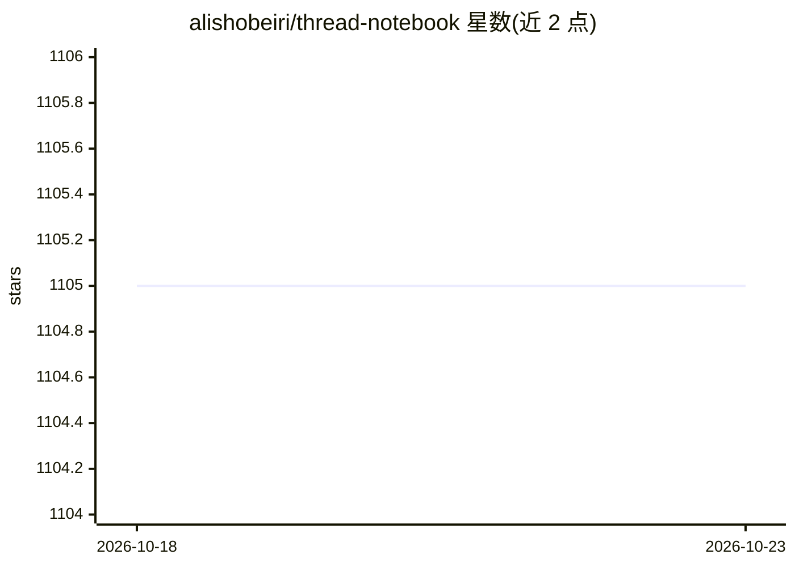

# alishobeiri/thread-notebook

⭐ 1,105 · JavaScript · AGPL-3.0 · 推送 2026-06-01 · [GitHub](https://github.com/alishobeiri/thread-notebook) · 个人维护

**带 AI 助手的 Jupyter Notebook 替代品：生成/编辑代码、修错、对话**

Thread 是一个本地运行的 Jupyter Notebook 替代编辑器，在熟悉的 Notebook 编辑体验中集成 AI 功能：自然语言编辑代码单元格、生成单元格回答自然语言问题、上下文感知的聊天侧边栏、自动解释或修复报错。通过 pip 安装，可用命令 thread-notebook 启动；支持接入 Ollama 实现完全离线使用，或使用自有 API key。前端基于 NextJS，开发模式需分别启动 Jupyter Server 与前端。

## 筛选速览

| 维度 | 判定 | 备注 |
|---|---|---|
| AI 角色 | `ai-native` | 本体是模型或模型工具 |
| 许可风险 | `viral` | AGPL-3.0 |
| 部署形态 | `library` | 以包/库形式分发 |
| 模型依赖 | local-ok | 支持本地模型 |
| 硬件要求 | — | 无带数字的原话,不猜 |
| 安装摩擦 | `low` | 无编译、无系统依赖或容器化 |
| 成熟度 | — | 结构信号不足 |

## 能力要点

- 自然语言编辑与生成代码单元格
- 上下文感知的聊天侧边栏
- 自动解释或修复错误
- 本地运行，可配合 Ollama 实现完全离线

## 适用场景

- 用自然语言生成或修改 Notebook 代码单元格
- 出错时自动获得解释与修复
- 离线环境下用 Ollama 完成 AI 辅助分析

## 场景标签

`AI 助手` `代码生成` · 领域:编码与开发

## 证据(README 行号)

> L5: Thread is a Jupyter alternative that integrates an AI copilot into your Jupyter Notebook editing experience.
> L7: Thread runs locally and can be used for free with Ollama or your own API key. To start:

## 星数曲线

2026-10-18 1,105 → 2026-10-23 1,105（+0）

---
*卡片 v1 · prompt 1.4 · 生成 2026-10-21 · 置信度 high · 依据 README sha `2c36db7d9605` · [字段定义](../../DATASET.md)*
