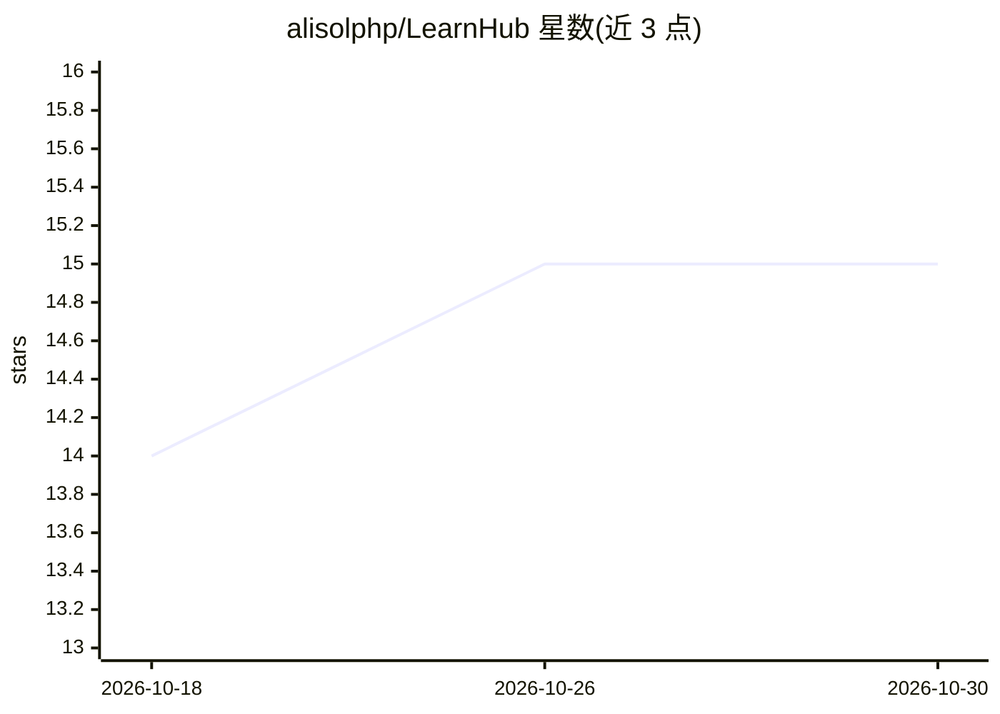

# alisolphp/LearnHub

⭐ 15 · JavaScript · NOASSERTION · 推送 2026-10-26 · [GitHub](https://github.com/alisolphp/LearnHub) · [官网](https://LearnHubAI.github.io) · 个人维护

**250+ 技术课程/面试主题摘要库，接入 AI 聊天机器人辅助学习**

个人维护的精选技术摘要合集，覆盖课程、YouTube 视频、书籍与模拟面试四类来源，含系统设计、算法、DevOps、数据库、Laravel 等主题。每篇摘要提供多语言入口与 AI 按钮（思维导图、闪卡、测验、高级教学、追问），用户在自己的 AI 聊天机器人中打开摘要文件进行提问、练习与面试模拟。摘要为个人笔记，声明非官方材料、不替代原始课程，内容不可众包编辑。提供 GitHub Pages 站点在线试用。

## 筛选速览

| 维度 | 判定 | 备注 |
|---|---|---|
| AI 角色 | `ai-knowledge` | 知识聚合/清单类 |
| 许可风险 | `none` | NOASSERTION |
| 部署形态 | `None` |  |
| 模型依赖 | — | README 未给出锁定关系 |
| 硬件要求 | — | 无带数字的原话,不猜 |
| 安装摩擦 | `medium` | 含编译或系统依赖之一 |
| 成熟度 | — | 结构信号不足 |

## 能力要点

- 250+ 篇课程/视频/书籍/模拟面试摘要
- 每篇摘要带思维导图、闪卡、测验、教学等 AI 工作流按钮
- 每篇摘要提供 16 种语言入口链接
- AI 辅助生成个性化快速学习计划

## 适用场景

- 面试前快速复习系统设计与算法主题
- 把摘要喂给 AI 聊天机器人做问答练习与闪卡测验
- 用母语深入学习英文技术课程内容

## 场景标签

`教程课程` `精选清单` · 领域:学习与行业

## 证据(README 行号)

> L163: LearnHub is a curated collection of concise, high-signal summaries for courses, YouTube videos, books, and mock in
> L187: 1. Open a `summary.*.md` file for the topic you are studying.
> L188: 2. Use the **AI buttons** at the top (teach / flashcards / quiz / projects / …), or:

## 星数曲线

2026-10-18 14 → 2026-10-30 15（+1）

---
*卡片 v1 · prompt 1.4 · 生成 2026-10-30 · 置信度 high · 依据 README sha `ef22195e4aef` · [字段定义](../../DATASET.md)*
