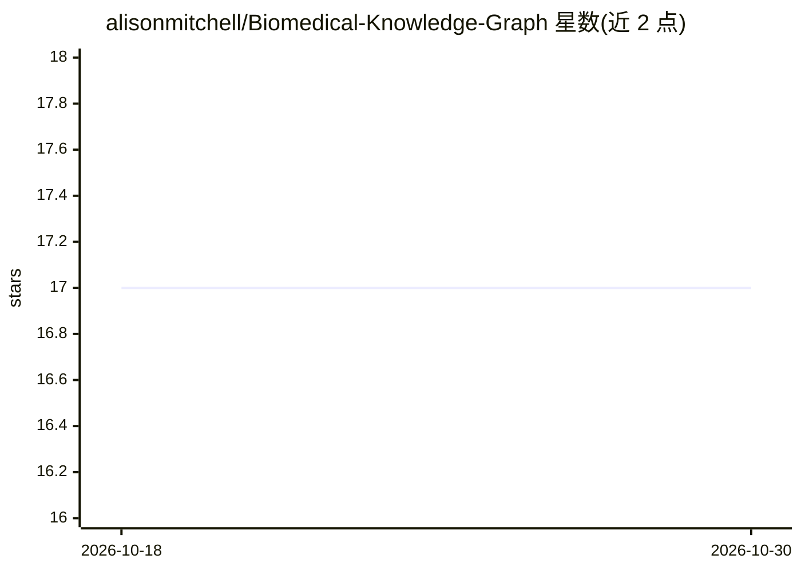

# alisonmitchell/Biomedical-Knowledge-Graph

⭐ 17 · Jupyter Notebook · 推送 2026-05-29 · [GitHub](https://github.com/alisonmitchell/Biomedical-Knowledge-Graph) · 个人维护

**从新冠药物重用文献抽取实体关系构建生物医学知识图谱**

面向生物医学研究者/科研用户的文本信息抽取项目：从 Europe PMC 与 arXiv 采集 COVID-19 药物重用相关论文，经 GROBID 解析 PDF、spaCy 预处理后，用 fastcoref 做共指消解、scispaCy/BERN2/KAZU 做命名实体识别与链接、REBEL 与 LLM（含 Groq API 少样本提示、Unsloth 监督微调）做关系抽取，输出三元组并经 NetworkX/Pyvis 可视化为交互式知识图谱，另含 EDA、聚类与主题建模（LDA/BERTopic）。README 为项目规划性描述，未给出安装或运行命令。

## 筛选速览

| 维度 | 判定 | 备注 |
|---|---|---|
| AI 角色 | `ai-native` | 本体是模型或模型工具 |
| 许可风险 | `none` | — |
| 部署形态 | `None` |  |
| 模型依赖 | — | README 未给出锁定关系 |
| 硬件要求 | — | 无带数字的原话,不猜 |
| 安装摩擦 | `low` | 无编译、无系统依赖或容器化 |
| 成熟度 | — | 结构信号不足 |

## 能力要点

- 共指消解→NER/链接→关系抽取的完整信息抽取流水线
- 融合传统 NLP、预训练 transformer 与 LLM 的混合方法
- REBEL 抽取三元组并经 LlamaIndex 索引供查询
- NetworkX/Pyvis 生成交互式知识图谱可视化

## 适用场景

- 我从新冠药物重用文献中抽取实体与关系构建知识图谱
- 我用 LLM 少样本提示替代领域专用模型做三元组抽取
- 我基于抽取结果预测药物副作用或推荐新适应症

## 场景标签

`知识图谱` `科研工具` · 领域:知识与检索

## 证据(README 行号)

> L38: The pipeline will take the preprocessed text as input, resolve coreferences using a neural model, classify entities
> L58: Relation Extraction is the final step in the information extraction pipeline and is the process of extracting relat

## 星数曲线

2026-10-18 17 → 2026-10-30 17（+0）

---
*卡片 v1 · prompt 1.4 · 生成 2026-10-29 · 置信度 high · 依据 README sha `429ecbc4630f` · [字段定义](../../DATASET.md)*
