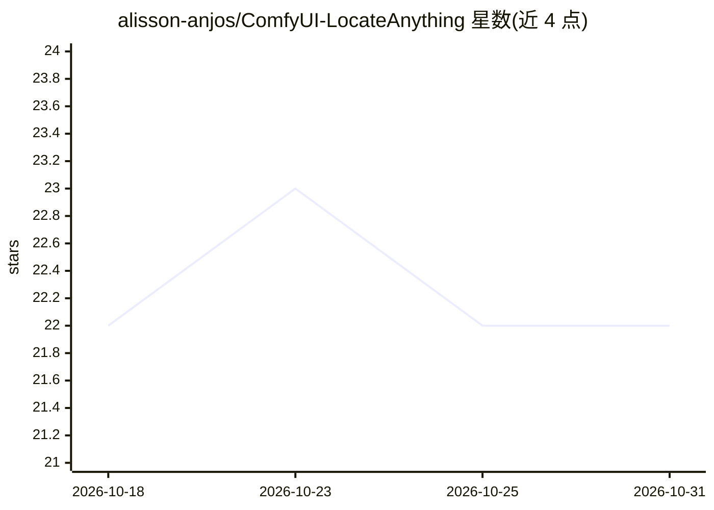

# alisson-anjos/ComfyUI-LocateAnything

⭐ 22 · Python · GPL-3.0 · 推送 2026-06-27 · [GitHub](https://github.com/alisson-anjos/ComfyUI-LocateAnything) · 个人维护

**ComfyUI 节点：封装 NVIDIA LocateAnything-3B 视觉定位模型**

为 NVIDIA LocateAnything-3B 视觉定位模型提供 ComfyUI 自定义节点：包含模型加载器（首次下载约 7.8GB 权重）、推理节点与模型卸载节点。推理节点逐帧处理 IMAGE 批次，支持目标检测、短语定位、文本定位、文档布局、GUI 定位与点定位等 10 种任务模式，输出结构化坐标、标注预览与掩码。含 transformers 兼容补丁与失败自动重试机制；通用 VQA 属实验性且质量不保证。模型权重为 NVIDIA 非商用许可，集成代码 GPL-3.0。

## 筛选速览

| 维度 | 判定 | 备注 |
|---|---|---|
| AI 角色 | `ai-native` | 本体是模型或模型工具 |
| 许可风险 | `dual` | GPL-3.0 |
| 部署形态 | `library` | 以包/库形式分发 |
| 模型依赖 | — | README 未给出锁定关系 |
| 硬件要求 | — | 无带数字的原话,不猜 |
| 安装摩擦 | `medium` | 含编译或系统依赖之一 |
| 成熟度 | — | 结构信号不足 |

## 能力要点

- 10 种任务模式：检测/短语定位/文本定位/GUI 定位/点定位等
- 逐帧处理 IMAGE 批次，输出坐标 JSON、标注图与掩码
- 加载时自动修补 transformers API 兼容性问题
- 采样失败自动降级重试（temperature=0 与 slow 模式）

## 适用场景

- 在 ComfyUI 中对图片或视频帧做目标定位与检测
- 生成检测框掩码接入下游裁剪/重绘工作流
- GUI 元素定位与文档布局分析

## 场景标签

`目标检测` · 领域:感知与多模态

## 证据(README 行号)

> L3: ComfyUI custom nodes for NVIDIA's LocateAnything-3B visual grounding model.
> L5: LocateAnything supports object detection, phrase grounding, text localization, document layout analysis, GUI groundi

## 星数曲线

2026-10-18 22 → 2026-10-31 22（+0）

---
*卡片 v1 · prompt 1.4 · 生成 2026-10-27 · 置信度 mid · 依据 README sha `cd03bcdefbc7` · [字段定义](../../DATASET.md)*
