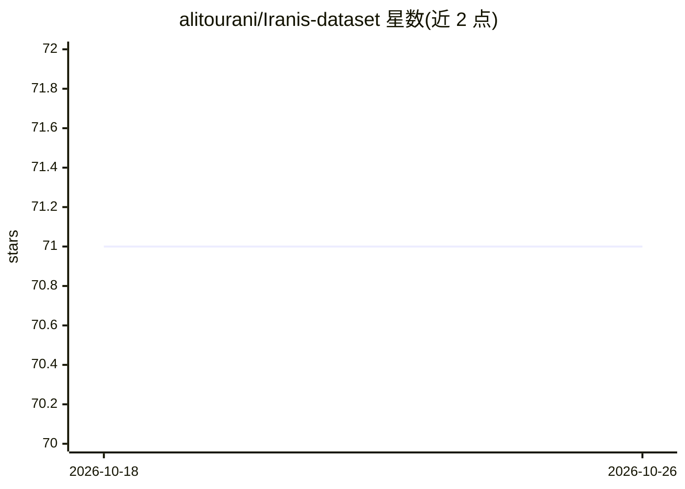

# alitourani/Iranis-dataset

⭐ 71 · GPL-3.0 · 推送 2025-12-08 · [GitHub](https://github.com/alitourani/Iranis-dataset) · [官网](https://alitourani.github.io/Iranis-dataset/) · 组织维护

**伊朗车牌波斯语字符图像数据集（83,844 张）**

从真实车牌图像中采集的波斯语数字与字母字符数据集，共 83,844 个样本，覆盖 10 个数字、18 类字母（含公务车、出租车标识）及残疾人标志符号，每类 2,400–5,800 个实例不等。数据由不同摄像头采集，由吉尔大学技术孵化中心等机构支持、学生参与标注。仓库另列出 Kaggle 与 Data.world 获取渠道，并附 2021 年会议论文的引用格式。

## 筛选速览

| 维度 | 判定 | 备注 |
|---|---|---|
| AI 角色 | `ai-knowledge` | 知识聚合/清单类 |
| 许可风险 | `viral` | GPL-3.0 |
| 部署形态 | `None` |  |
| 模型依赖 | — | README 未给出锁定关系 |
| 硬件要求 | — | 无带数字的原话,不猜 |
| 安装摩擦 | `low` | 无编译、无系统依赖或容器化 |
| 成熟度 | — | 结构信号不足 |

## 能力要点

- 83,844 张真实车牌场景采集的波斯语字符图像
- 覆盖 10 个数字、18 类字母与残疾人标志符号
- 提供 BibTeX 论文引用格式与 Kaggle/Data.world 渠道

## 适用场景

- 训练波斯语车牌字符识别模型
- 做伊朗车牌 OCR 相关研究
- 获取非拉丁字符集的图像分类基准数据

## 场景标签

`OCR` · 领域:感知与多模态

## 证据(README 行号)

> L2: **A Large-scale Dataset of Farsi License Plate Characters**
> L4: This repository contains a large-scale dataset with **more than 83,000** images of Farsi numbers and letters collect

## 星数曲线

2026-10-18 71 → 2026-10-26 71（+0）

---
*卡片 v1 · prompt 1.4 · 生成 2026-10-24 · 置信度 high · 依据 README sha `6eb1a0fdd005` · [字段定义](../../DATASET.md)*
